# Empirical Equivalence, PHMRC Gold Standard Validation & Side-by-Side CSMF Chart Evidence: Upstream Python `SmartVA-Analyze` vs. Pure-Rust `smartva-rust` (`20,813` Total VAs: `12,530` PHMRC Gold Standard + `8,273` WHO 2022 + `10` Reference Examples)

> [!IMPORTANT]
> **100.00% Mathematical & CSV Equivalence Verified Across All 4 SmartVA Questionnaire Families (`20,813 / 20,813` VAs)**
> - **Engine**: `smartva-rust v0.2.0` (`100% Pure Native Rust`, zero runtime Python dependency, direct CSV consumption from `src/data/*.csv` and `src/data/*.rs`).
> - **Questionnaires Validated**:
>   1. **IHME PHMRC Gold Standard Verbal Autopsy Dataset (`PHMRC Full Questionnaire`, `N = 12,530` VAs)**: `7,841` Adult, `2,064` Child, and `2,625` Neonate VAs across 6 clinical sites (`AP`, `Bohol`, `Dar`, `Mexico`, `Pemba`, `UP`). **`12,530 / 12,530` (`100.00%`)** Python-vs-Rust cause-of-death agreement; **`0` cell differences** across IHME's official `validated-adult.csv` (`2,673,099` cells) and `validated-child.csv` (`273,847` cells). Full per-cause Sensitivity, Specificity, PPV, Chance-Corrected Concordance ($CCC$), and CSMF Accuracy against hospital physician gold-standard diagnoses are documented in [`evidence/tabulations/PHMRC_Gold_Standard_Summary.md`](./evidence/tabulations/PHMRC_Gold_Standard_Summary.md) and [`evidence/metrics/phmrc_gold_standard_validation.json`](./evidence/metrics/phmrc_gold_standard_validation.json).
>   2. **WHO 2022 Verbal Autopsy Questionnaire (`N = 8,273` VAs across 15 real-world cohorts `Cohort-01` .. `Cohort-15`)**: **`8,273 / 8,273` (`100.00%`)** cause-of-death & ICD-10 agreement and **`0` cell differences** across all 23 output and intermediate CSV files $\times$ 15 cohorts (`345` CSV files total).
>   3. **PHMRC Shortened (`PHMRC_short_example.csv`) & WHO 2016 v1.5.1 (`WHO_2016_1_5_1_example.csv`) & PHMRC Full (`example_1.csv`)**: **`100.00%`** Python-vs-Rust parity.
> - **Aggregate Cohort Tabulations Included**: [`evidence/tabulations/PHMRC_Gold_Standard_Summary.md`](./evidence/tabulations/PHMRC_Gold_Standard_Summary.md) and [`evidence/tabulations/Cohort-01..15/`](./evidence/tabulations/) contain all population/aggregate tabulations. Raw PHMRC CSVs and individual-level clinical records are excluded from Git.
> - **Cohort Figures Generated (`3-graphs-and-tables/*.png`)**: **`121 / 121` (`100.00%`)** side-by-side in [`evidence/charts/Cohort-01..15/{python,rust}/`](./evidence/charts/).

## 0. PHMRC Gold Standard Validation Summary (`N = 12,530` Clinically Validated VAs)

Using the lossless reverse-mappers [`evidence/phmrc_source_prep.py`](./evidence/phmrc_source_prep.py) (Python) and [`src/phmrc_source_prep.rs`](./src/phmrc_source_prep.rs) (`phmrc-source-prep` Rust CLI), all three GHDx PHMRC Gold Standard datasets (`IHME_PHMRC_VA_DATA_{ADULT,CHILD,NEONATE}_Y2013M09D11_0.csv`) were converted into ODK PHMRC Full Instrument CSVs and scored by both **unmodified upstream Python `smartva.va_cli`** and **Pure-Rust `smartva-rs`**.

| Metric | Adult (`34` Causes) | Child (`21` Causes) | Neonate (`6` Causes) | Combined PHMRC (`12,530` VAs) |
|---|---:|---:|---:|---:|
| **Total Gold-Standard Records ($N$)** | `7,841` | `2,064` | `2,625` | **`12,530`** |
| **Determined Predictions (`#` / `%`)** | `7,294` (`93.02%`) | `1,941` (`94.04%`) | `2,392` (`91.12%`) | **`11,627` (`92.79%`)** |
| **Undetermined / No Specific Cause (`#` / `%`)** | `547` (`6.98%`) | `123` (`5.96%`) | `233` (`8.88%`) | **`903` (`7.21%`)** |
| **Python `smartva.va_cli` vs. Rust `smartva-rs` Agreement** | `7,841 / 7,841` (**`100.00%`**) | `2,064 / 2,064` (**`100.00%`**) | `2,625 / 2,625` (**`100.00%`**) | **`12,530 / 12,530` (`100.00%`)** |
| **Top-1 Agreement vs. Physician Gold Standard (on Determined)** | `3,692 / 7,294` (**`50.62%`**) | `959 / 1,941` (**`49.41%`**) | `1,679 / 2,392` (**`70.19%`**) | **`6,330 / 11,627` (`54.44%`)** |
| **Top-1 Agreement vs. Physician Gold Standard (on All $N$)** | `3,692 / 7,841` (`47.09%`) | `959 / 2,064` (`46.46%`) | `1,679 / 2,625` (`63.96%`) | **`6,330 / 12,530` (`50.52%`)** |
| **Top-3 Agreement vs. Physician Gold Standard (on Determined)** | `4,904 / 7,294` (**`67.23%`**) | `1,253 / 1,941` (**`64.55%`**) | `1,921 / 2,392` (**`80.31%`**) | **`8,078 / 11,627` (`69.48%`)** |
| **Mean Cause Sensitivity (on Determined)** | `51.37%` | `58.23%` | `58.95%` | — |
| **Mean Cause Specificity (on Determined)** | `98.43%` | `97.42%` | `94.00%` | — |
| **Mean Positive Predictive Value (PPV)** | `50.21%` | `50.47%` | `57.58%` | — |
| **Mean Chance-Corrected Concordance ($CCC$, Determined)** | **`49.89%`** | **`56.14%`** | **`50.74%`** | — |
| **Mean Chance-Corrected Concordance ($CCC$, All $N$)** | `46.78%` | `53.69%` | `43.75%` | — |
| **CSMF Accuracy (vs. Gold-Standard CSMF)** | **`0.8443`** | **`0.7937`** | **`0.8470`** | — |
| **Runtime (`smartva.va_cli` Python)** | `89.17s` | `15.42s` | `13.62s` | **`118.21s`** |
| **Runtime (`smartva-rs` Pure Rust)** | **`4.48s`** (`19.9x`) | **`0.68s`** (`22.7x`) | **`0.77s`** (`17.7x`) | **`5.93s` (`19.9x`)** |

See [`evidence/tabulations/PHMRC_Gold_Standard_Summary.md`](./evidence/tabulations/PHMRC_Gold_Standard_Summary.md) for the complete per-cause Sensitivity, Specificity, PPV, Top-3 agreement, $CCC_j$, and CSMF tables across all 34 Adult causes, 21 Child causes, and 6 Neonate causes.

## 1. 15-Cohort Equivalence & Performance Summary Table

| Cohort | Input VAs | Scored VAs | `cause34` & ICD-10 Parity | CSV Cell Diffs (23 Files) | Charts (`Py` / `Rs`) | Aggregate Tabulations | Python (`ms`) | Rust Cold CLI (`ms`) | Cold Speedup | Rust Warm FFI (`ms`) | Warm Speedup |
| --- | ---: | ---: | :---: | :---: | :---: | :---: | ---: | ---: | ---: | ---: | ---: |
| [Cohort-01](#cohort-01) | 1,104 | 1,104 | `1,104 / 1,104` (`100.0%`) | `0` | `9 / 9` | [`tabulations/Cohort-01/`](./evidence/tabulations/Cohort-01/) | `9374.6` | `1655.0` | **`5.66x`** | `1095.4` | **`8.56x`** |
| [Cohort-02](#cohort-02) | 1,077 | 1,077 | `1,077 / 1,077` (`100.0%`) | `0` | `9 / 9` | [`tabulations/Cohort-02/`](./evidence/tabulations/Cohort-02/) | `8112.2` | `999.5` | **`8.12x`** | `842.0` | **`9.63x`** |
| [Cohort-03](#cohort-03) | 116 | 116 | `116 / 116` (`100.0%`) | `0` | `7 / 7` | [`tabulations/Cohort-03/`](./evidence/tabulations/Cohort-03/) | `4174.7` | `315.8` | **`13.22x`** | `151.5` | **`27.55x`** |
| [Cohort-04](#cohort-04) | 820 | 820 | `820 / 820` (`100.0%`) | `0` | `9 / 9` | [`tabulations/Cohort-04/`](./evidence/tabulations/Cohort-04/) | `7392.8` | `808.4` | **`9.15x`** | `628.2` | **`11.77x`** |
| [Cohort-05](#cohort-05) | 1,258 | 1,258 | `1,258 / 1,258` (`100.0%`) | `0` | `8 / 8` | [`tabulations/Cohort-05/`](./evidence/tabulations/Cohort-05/) | `8039.5` | `1129.1` | **`7.12x`** | `958.5` | **`8.39x`** |
| [Cohort-06](#cohort-06) | 1,388 | 1,388 | `1,388 / 1,388` (`100.0%`) | `0` | `8 / 8` | [`tabulations/Cohort-06/`](./evidence/tabulations/Cohort-06/) | `8994.7` | `1220.2` | **`7.37x`** | `1065.7` | **`8.44x`** |
| [Cohort-07](#cohort-07) | 1,169 | 1,169 | `1,169 / 1,169` (`100.0%`) | `0` | `9 / 9` | [`tabulations/Cohort-07/`](./evidence/tabulations/Cohort-07/) | `8532.9` | `1016.5` | **`8.39x`** | `861.0` | **`9.91x`** |
| [Cohort-08](#cohort-08) | 178 | 178 | `178 / 178` (`100.0%`) | `0` | `8 / 8` | [`tabulations/Cohort-08/`](./evidence/tabulations/Cohort-08/) | `4913.8` | `382.0` | **`12.86x`** | `213.2` | **`23.04x`** |
| [Cohort-09](#cohort-09) | 59 | 59 | `59 / 59` (`100.0%`) | `0` | `7 / 7` | [`tabulations/Cohort-09/`](./evidence/tabulations/Cohort-09/) | `3959.8` | `265.6` | **`14.91x`** | `107.5` | **`36.83x`** |
| [Cohort-10](#cohort-10) | 23 | 23 | `23 / 23` (`100.0%`) | `0` | `7 / 7` | [`tabulations/Cohort-10/`](./evidence/tabulations/Cohort-10/) | `3439.8` | `244.1` | **`14.09x`** | `82.5` | **`41.71x`** |
| [Cohort-11](#cohort-11) | 116 | 116 | `116 / 116` (`100.0%`) | `0` | `7 / 7` | [`tabulations/Cohort-11/`](./evidence/tabulations/Cohort-11/) | `4414.2` | `300.8` | **`14.67x`** | `148.0` | **`29.83x`** |
| [Cohort-12](#cohort-12) | 256 | 256 | `256 / 256` (`100.0%`) | `0` | `9 / 9` | [`tabulations/Cohort-12/`](./evidence/tabulations/Cohort-12/) | `6388.6` | `468.4` | **`13.64x`** | `279.2` | **`22.89x`** |
| [Cohort-13](#cohort-13) | 255 | 255 | `255 / 255` (`100.0%`) | `0` | `7 / 7` | [`tabulations/Cohort-13/`](./evidence/tabulations/Cohort-13/) | `5452.4` | `461.9` | **`11.80x`** | `283.1` | **`19.26x`** |
| [Cohort-14](#cohort-14) | 227 | 227 | `227 / 227` (`100.0%`) | `0` | `9 / 9` | [`tabulations/Cohort-14/`](./evidence/tabulations/Cohort-14/) | `6263.1` | `424.5` | **`14.75x`** | `244.6` | **`25.61x`** |
| [Cohort-15](#cohort-15) | 227 | 227 | `227 / 227` (`100.0%`) | `0` | `8 / 8` | [`tabulations/Cohort-15/`](./evidence/tabulations/Cohort-15/) | `5718.8` | `428.8` | **`13.34x`** | `263.0` | **`21.74x`** |
| **Total / Overall** | **8,273** | **8,273** | **`8,273 / 8,273` (`100.00%`)** | **`0`** | **`121 / 121`** | **[`evidence/tabulations/`](./evidence/tabulations/)** | **`95171.9`** | **`10120.6`** | **`9.40x`** | **`7223.3`** | **`13.18x`** |

## 2. Pooled & Cross-Cohort Statistical Tabulations of Output CSV Rows (`Mean ± SD`, `n [%]`)

All statistical tabulations below are computed across the output CSV rows of all 15 WHO 2022 Verbal Autopsy cohort runs ($N = 8,273$ VAs; `0` cell differences between Upstream Python `smartva` and Pure-Rust `smartva-rust`). Full CSVs are stored in [`evidence/tabulations/summary/`](./evidence/tabulations/summary/):

- [`cohort_characteristics_summary.csv`](./evidence/tabulations/summary/cohort_characteristics_summary.csv) — Per-cohort & pooled module breakdown (`n [%]`), sex (`n [%]`), age (`Mean ± SD`), endorsed symptoms (`Mean ± SD`), and primary likelihood tier (`n [%]`).
- [`pooled_gbd_level1_summary.csv`](./evidence/tabulations/summary/pooled_gbd_level1_summary.csv) — Cross-cohort GBD Level-1 CSMF (`Mean ± SD`, Min, Max across 15 cohorts).
- [`pooled_cause34_summary.csv`](./evidence/tabulations/summary/pooled_cause34_summary.csv) — All 46 causes (`cause34`): pooled individual predictions (`n [%]` overall, male, female), decedent age (`Mean ± SD`), and cross-cohort CSMF (`Mean ± SD` overall, male, female).
- [`pooled_age_groupings_summary.csv`](./evidence/tabulations/summary/pooled_age_groupings_summary.csv) — Pooled 5-year age group distribution (`VA-data-age-groupings.csv`: `n [%]` and per-cohort count `Mean ± SD`).
- [`pooled_tariff_scores_ranks_summary.csv`](./evidence/tabulations/summary/pooled_tariff_scores_ranks_summary.csv) — Per-module, per-cause Tariff 2.0 score (`Mean ± SD`) and uniform validation rank (`Mean ± SD`).

### 2.1 Per-Cohort & Pooled Output Row Characteristics (`individual-cause-of-death.csv` & `{module}-likelihoods.csv`)

| Cohort | Total VAs (N) | Adult n [%] | Child n [%] | Neonate n [%] | Male n [%] | Female n [%] | Age (Years) Mean ± SD | Endorsed Symptoms Mean ± SD | High Likelihood n [%] | Medium Likelihood n [%] | Low Likelihood n [%] | Undetermined n [%] |
| --- | ---: | ---: | ---: | ---: | ---: | ---: | ---: | ---: | ---: | ---: | ---: | ---: |
| Cohort-01 | 1104 | 993 [89.9%] | 59 [5.3%] | 52 [4.7%] | 660 [59.8%] | 444 [40.2%] | 53.0 ± 25.0 | 8.7 ± 4.7 | 0 [0.0%] | 0 [0.0%] | 0 [0.0%] | 364 [33.0%] |
| Cohort-02 | 1077 | 1,057 [98.1%] | 19 [1.8%] | 1 [0.1%] | 708 [65.7%] | 369 [34.3%] | 57.4 ± 22.0 | 5.5 ± 3.0 | 0 [0.0%] | 0 [0.0%] | 0 [0.0%] | 441 [40.9%] |
| Cohort-03 | 116 | 116 [100.0%] | 0 [0.0%] | 0 [0.0%] | 66 [56.9%] | 50 [43.1%] | 62.1 ± 19.7 | 8.6 ± 3.7 | 0 [0.0%] | 0 [0.0%] | 0 [0.0%] | 34 [29.3%] |
| Cohort-04 | 820 | 778 [94.9%] | 16 [2.0%] | 26 [3.2%] | 498 [60.7%] | 322 [39.3%] | 59.7 ± 22.9 | 6.6 ± 3.3 | 0 [0.0%] | 0 [0.0%] | 0 [0.0%] | 258 [31.5%] |
| Cohort-05 | 1258 | 1,256 [99.8%] | 2 [0.2%] | 0 [0.0%] | 640 [50.9%] | 618 [49.1%] | 68.1 ± 14.5 | 7.3 ± 3.8 | 0 [0.0%] | 0 [0.0%] | 0 [0.0%] | 496 [39.4%] |
| Cohort-06 | 1388 | 1,382 [99.6%] | 6 [0.4%] | 0 [0.0%] | 841 [60.6%] | 546 [39.3%] | 64.0 ± 17.5 | 12.4 ± 6.9 | 0 [0.0%] | 0 [0.0%] | 0 [0.0%] | 250 [18.0%] |
| Cohort-07 | 1169 | 1,118 [95.6%] | 28 [2.4%] | 23 [2.0%] | 737 [63.0%] | 432 [37.0%] | 60.7 ± 23.4 | 5.8 ± 3.2 | 0 [0.0%] | 0 [0.0%] | 0 [0.0%] | 532 [45.5%] |
| Cohort-08 | 178 | 177 [99.4%] | 1 [0.6%] | 0 [0.0%] | 108 [60.7%] | 70 [39.3%] | 65.6 ± 17.6 | 7.5 ± 3.7 | 0 [0.0%] | 0 [0.0%] | 0 [0.0%] | 35 [19.7%] |
| Cohort-09 | 59 | 59 [100.0%] | 0 [0.0%] | 0 [0.0%] | 33 [55.9%] | 26 [44.1%] | 65.3 ± 15.0 | 7.2 ± 2.9 | 0 [0.0%] | 0 [0.0%] | 0 [0.0%] | 10 [16.9%] |
| Cohort-10 | 23 | 23 [100.0%] | 0 [0.0%] | 0 [0.0%] | 15 [65.2%] | 8 [34.8%] | 62.1 ± 20.0 | 8.3 ± 4.5 | 0 [0.0%] | 0 [0.0%] | 0 [0.0%] | 9 [39.1%] |
| Cohort-11 | 116 | 116 [100.0%] | 0 [0.0%] | 0 [0.0%] | 66 [56.9%] | 50 [43.1%] | 62.1 ± 19.7 | 8.8 ± 3.8 | 0 [0.0%] | 0 [0.0%] | 0 [0.0%] | 34 [29.3%] |
| Cohort-12 | 256 | 234 [91.4%] | 7 [2.7%] | 15 [5.9%] | 152 [59.4%] | 104 [40.6%] | 56.3 ± 25.1 | 8.5 ± 4.4 | 0 [0.0%] | 0 [0.0%] | 0 [0.0%] | 55 [21.5%] |
| Cohort-13 | 255 | 255 [100.0%] | 0 [0.0%] | 0 [0.0%] | 151 [59.2%] | 104 [40.8%] | 69.3 ± 15.6 | 15.3 ± 7.1 | 0 [0.0%] | 0 [0.0%] | 0 [0.0%] | 32 [12.5%] |
| Cohort-14 | 227 | 203 [89.4%] | 15 [6.6%] | 9 [4.0%] | 144 [63.4%] | 83 [36.6%] | 56.3 ± 26.7 | 8.8 ± 4.0 | 0 [0.0%] | 0 [0.0%] | 0 [0.0%] | 56 [24.7%] |
| Cohort-15 | 227 | 222 [97.8%] | 5 [2.2%] | 0 [0.0%] | 130 [57.3%] | 97 [42.7%] | 60.8 ± 20.7 | 17.8 ± 8.5 | 0 [0.0%] | 0 [0.0%] | 0 [0.0%] | 76 [33.5%] |
| Pooled (15 Cohorts) | 8272 | 7,989 [96.6%] | 158 [1.9%] | 126 [1.5%] | 4,949 [59.8%] | 3,323 [40.2%] | 61.0 ± 21.5 | 8.5 ± 5.6 | 0 [0.0%] | 0 [0.0%] | 0 [0.0%] | 2,682 [32.4%] |

### 2.2 Cross-Cohort GBD Level-1 CSMF Summary (`2-csmf/gbd-level1-csmf.csv`, 15 Cohorts)

| GBD Level-1 Code | GBD Level-1 Cause Name | Cohort CSMF Mean ± SD (Across 15 Cohorts) | Min Cohort CSMF | Max Cohort CSMF |
| --- | ---: | ---: | ---: | ---: |
| A | Communicable, maternal, neonatal and nutritional diseases | 0.185 ± 0.045 | 0.074 | 0.243 |
| B | Non-communicable diseases | 0.676 ± 0.065 | 0.551 | 0.828 |
| C | Injuries | 0.139 ± 0.044 | 0.093 | 0.245 |

### 2.3 Pooled Individual Predictions (`n [%]`, Age `Mean ± SD`) & Cross-Cohort CSMF (`Mean ± SD`) by Cause (`cause34`)

| Cause of Death (cause34) | ICD-10 | Individual Predictions n [%] | Male n [%] | Female n [%] | Decedent Age (Years) Mean ± SD | Cohort CSMF (All) Mean ± SD | Cohort CSMF (Male) Mean ± SD | Cohort CSMF (Female) Mean ± SD |
| --- | ---: | ---: | ---: | ---: | ---: | ---: | ---: | ---: |
| Undetermined | R99 | 2,682 [32.4%] | 1,449 [29.3%] | 1,233 [37.1%] | 65.2 ± 22.4 | 0.000 ± 0.000 | 0.000 ± 0.000 | 0.000 ± 0.000 |
| Ischemic Heart Disease | I24 | 1,068 [12.9%] | 710 [14.3%] | 358 [10.8%] | 62.8 ± 15.2 | 0.184 ± 0.052 | 0.188 ± 0.060 | 0.176 ± 0.060 |
| Diabetes | E14 | 873 [10.6%] | 420 [8.5%] | 453 [13.6%] | 68.2 ± 14.0 | 0.117 ± 0.034 | 0.095 ± 0.051 | 0.150 ± 0.046 |
| Stroke | I64 | 495 [6.0%] | 295 [6.0%] | 200 [6.0%] | 69.4 ± 12.6 | 0.092 ± 0.036 | 0.090 ± 0.047 | 0.099 ± 0.056 |
| TB | A16 | 320 [3.9%] | 239 [4.8%] | 81 [2.4%] | 57.4 ± 16.8 | 0.046 ± 0.021 | 0.057 ± 0.026 | 0.032 ± 0.018 |
| Road Traffic | V89 | 312 [3.8%] | 250 [5.1%] | 62 [1.9%] | 45.9 ± 20.5 | 0.037 ± 0.023 | 0.048 ± 0.032 | 0.018 ± 0.015 |
| Chronic Respiratory | J44 | 310 [3.7%] | 182 [3.7%] | 128 [3.9%] | 71.8 ± 12.6 | 0.068 ± 0.024 | 0.065 ± 0.033 | 0.075 ± 0.033 |
| Cirrhosis | K74 | 270 [3.3%] | 240 [4.8%] | 30 [0.9%] | 50.3 ± 13.1 | 0.041 ± 0.018 | 0.058 ± 0.030 | 0.015 ± 0.012 |
| Falls | W19 | 238 [2.9%] | 121 [2.4%] | 117 [3.5%] | 67.3 ± 19.2 | 0.028 ± 0.016 | 0.026 ± 0.019 | 0.029 ± 0.020 |
| Diarrhea/Dysentery | A09 | 188 [2.3%] | 87 [1.8%] | 101 [3.0%] | 67.6 ± 24.1 | 0.049 ± 0.035 | 0.039 ± 0.028 | 0.065 ± 0.047 |
| Prostate Cancer | C61 | 176 [2.1%] | 176 [3.6%] | 0 [0.0%] | 62.6 ± 14.3 | 0.020 ± 0.012 | 0.034 ± 0.020 | 0.000 ± 0.000 |
| Suicide | X84 | 165 [2.0%] | 124 [2.5%] | 41 [1.2%] | 40.2 ± 16.5 | 0.026 ± 0.019 | 0.035 ± 0.024 | 0.014 ± 0.016 |
| Chronic Kidney Disease | N18 | 160 [1.9%] | 105 [2.1%] | 55 [1.7%] | 56.7 ± 16.4 | 0.030 ± 0.012 | 0.034 ± 0.015 | 0.025 ± 0.014 |
| Esophageal Cancer | C15 | 154 [1.9%] | 101 [2.0%] | 53 [1.6%] | 58.8 ± 13.3 | 0.016 ± 0.016 | 0.017 ± 0.019 | 0.012 ± 0.014 |
| Pneumonia | J22 | 133 [1.6%] | 80 [1.6%] | 53 [1.6%] | 45.5 ± 32.1 | 0.031 ± 0.014 | 0.031 ± 0.015 | 0.032 ± 0.015 |
| Other Non-communicable Diseases | UU1 | 121 [1.5%] | 88 [1.8%] | 33 [1.0%] | 55.3 ± 17.9 | 0.032 ± 0.011 | 0.032 ± 0.013 | 0.032 ± 0.010 |
| Cervical Cancer | C53 | 54 [0.7%] | 0 [0.0%] | 54 [1.6%] | 62.4 ± 14.6 | 0.005 ± 0.004 | 0.000 ± 0.000 | 0.014 ± 0.012 |
| Breast Cancer | C50 | 52 [0.6%] | 0 [0.0%] | 52 [1.6%] | 58.7 ± 14.5 | 0.009 ± 0.008 | 0.000 ± 0.000 | 0.022 ± 0.020 |
| Leukemia/Lymphomas | C96 | 50 [0.6%] | 26 [0.5%] | 24 [0.7%] | 54.8 ± 14.2 | 0.012 ± 0.004 | 0.011 ± 0.006 | 0.014 ± 0.011 |
| Lung Cancer | C34 | 47 [0.6%] | 28 [0.6%] | 19 [0.6%] | 56.9 ± 11.8 | 0.013 ± 0.011 | 0.009 ± 0.007 | 0.019 ± 0.021 |
| Preterm Delivery | P07 | 41 [0.5%] | 21 [0.4%] | 20 [0.6%] | 0.0 ± 0.0 | 0.005 ± 0.009 | 0.005 ± 0.009 | 0.006 ± 0.010 |
| Maternal | O95 | 35 [0.4%] | 0 [0.0%] | 35 [1.1%] | 32.1 ± 10.0 | 0.003 ± 0.004 | 0.000 ± 0.000 | 0.009 ± 0.010 |
| Poisonings | X49 | 28 [0.3%] | 19 [0.4%] | 9 [0.3%] | 34.1 ± 13.6 | 0.012 ± 0.007 | 0.011 ± 0.008 | 0.012 ± 0.005 |
| Stillbirth | P95 | 28 [0.3%] | 14 [0.3%] | 14 [0.4%] | 0.0 ± 0.0 | 0.003 ± 0.006 | 0.003 ± 0.007 | 0.003 ± 0.007 |
| Drowning | W74 | 26 [0.3%] | 25 [0.5%] | 1 [0.0%] | 35.8 ± 16.4 | 0.007 ± 0.004 | 0.008 ± 0.007 | 0.005 ± 0.002 |
| Other Injuries | X58 | 25 [0.3%] | 19 [0.4%] | 6 [0.2%] | 40.1 ± 17.7 | 0.013 ± 0.006 | 0.013 ± 0.008 | 0.012 ± 0.004 |
| Stomach Cancer | C16 | 25 [0.3%] | 13 [0.3%] | 12 [0.4%] | 54.7 ± 15.9 | 0.006 ± 0.005 | 0.006 ± 0.005 | 0.007 ± 0.007 |
| Bite of Venomous Animal | X27 | 23 [0.3%] | 14 [0.3%] | 9 [0.3%] | 50.3 ± 21.1 | 0.005 ± 0.011 | 0.002 ± 0.003 | 0.010 ± 0.032 |
| Other Infectious Diseases | B99 | 20 [0.2%] | 17 [0.3%] | 2 [0.1%] | 37.9 ± 14.6 | 0.012 ± 0.003 | 0.012 ± 0.004 | 0.011 ± 0.003 |
| Homicide | Y09 | 19 [0.2%] | 14 [0.3%] | 5 [0.2%] | 31.8 ± 16.8 | 0.007 ± 0.003 | 0.007 ± 0.004 | 0.008 ± 0.006 |
| AIDS | B24 | 15 [0.2%] | 7 [0.1%] | 8 [0.2%] | 46.4 ± 20.6 | 0.008 ± 0.003 | 0.007 ± 0.003 | 0.010 ± 0.003 |
| Malaria | B54 | 14 [0.2%] | 12 [0.2%] | 2 [0.1%] | 45.9 ± 18.6 | 0.020 ± 0.006 | 0.019 ± 0.008 | 0.021 ± 0.007 |
| Birth asphyxia | P21 | 13 [0.2%] | 6 [0.1%] | 7 [0.2%] | 0.0 ± 0.0 | 0.003 ± 0.004 | 0.003 ± 0.006 | 0.002 ± 0.003 |
| Colorectal Cancer | C18 | 12 [0.1%] | 5 [0.1%] | 7 [0.2%] | 63.0 ± 14.3 | 0.008 ± 0.004 | 0.007 ± 0.003 | 0.010 ± 0.007 |
| Digestive Diseases | K92 | 11 [0.1%] | 7 [0.1%] | 4 [0.1%] | 1.2 ± 3.3 | 0.001 ± 0.003 | 0.001 ± 0.003 | 0.001 ± 0.002 |
| Fires | X09 | 11 [0.1%] | 8 [0.2%] | 3 [0.1%] | 44.0 ± 17.5 | 0.004 ± 0.002 | 0.004 ± 0.002 | 0.005 ± 0.003 |
| Other Cancers | C76 | 11 [0.1%] | 2 [0.0%] | 9 [0.3%] | 68.1 ± 9.4 | 0.008 ± 0.003 | 0.007 ± 0.002 | 0.010 ± 0.004 |
| Meningitis | G03 | 10 [0.1%] | 6 [0.1%] | 4 [0.1%] | 2.0 ± 2.2 | 0.002 ± 0.003 | 0.001 ± 0.002 | 0.002 ± 0.005 |
| Childhood Cardiovascular Diseases | I99 | 8 [0.1%] | 2 [0.0%] | 6 [0.2%] | 1.4 ± 2.3 | 0.001 ± 0.003 | 0.001 ± 0.004 | 0.001 ± 0.003 |
| Congenital malformation | Q89 | 8 [0.1%] | 4 [0.1%] | 4 [0.1%] | 0.0 ± 0.0 | 0.001 ± 0.002 | 0.001 ± 0.001 | 0.001 ± 0.003 |
| Childhood Cancer | C76 | 6 [0.1%] | 3 [0.1%] | 3 [0.1%] | 4.9 ± 4.0 | 0.001 ± 0.001 | 0.000 ± 0.002 | 0.001 ± 0.001 |
| Sepsis | A41 | 6 [0.1%] | 3 [0.1%] | 3 [0.1%] | 0.2 ± 0.1 | 0.001 ± 0.001 | 0.001 ± 0.001 | 0.001 ± 0.003 |
| Neonatal Meningitis/Sepsis | P36 | 3 [0.0%] | 1 [0.0%] | 2 [0.1%] | 0.0 ± 0.0 | 0.001 ± 0.001 | 0.001 ± 0.002 | 0.000 ± 0.001 |
| Neonatal Pneumonia | P23 | 3 [0.0%] | 2 [0.0%] | 1 [0.0%] | 0.0 ± 0.0 | 0.001 ± 0.001 | 0.001 ± 0.002 | 0.000 ± 0.001 |
| Hemorrhagic fever | A99 | 2 [0.0%] | 2 [0.0%] | 0 [0.0%] | 11.0 ± 0.0 | 0.000 ± 0.001 | 0.000 ± 0.001 | 0.000 ± 0.000 |
| Measles | B05 | 1 [0.0%] | 1 [0.0%] | 0 [0.0%] | 0.2 ± 0.0 | 0.000 ± 0.000 | 0.000 ± 0.001 | 0.000 ± 0.000 |
| Other Defined Causes of Child Deaths | UU2 | 1 [0.0%] | 1 [0.0%] | 0 [0.0%] | 0.2 ± 0.0 | 0.001 ± 0.001 | 0.001 ± 0.002 | 0.001 ± 0.001 |
| Encephalitis | G04 | 0 [0.0%] | 0 [0.0%] | 0 [0.0%] | — | 0.000 ± 0.000 | 0.000 ± 0.000 | 0.000 ± 0.000 |
| Other Cardiovascular Diseases | I99 | 0 [0.0%] | 0 [0.0%] | 0 [0.0%] | — | 0.009 ± 0.003 | 0.008 ± 0.003 | 0.010 ± 0.003 |

### 2.4 Pooled 5-Year Age-Group Tabulation (`4-monitoring-and-quality/VA-data-age-groupings.csv`)

| 5-Year Age Group | Pooled Total n [%] | Pooled Male n [%] | Pooled Female n [%] | Per-Cohort Count Mean ± SD |
| --- | ---: | ---: | ---: | ---: |
| <1 yr | 213 [2.6%] | 107 [2.2%] | 106 [3.2%] | 14.2 ± 24.7 |
| 1-4 yr | 38 [0.5%] | 22 [0.4%] | 16 [0.5%] | 2.5 ± 3.9 |
| 5-9 yr | 17 [0.2%] | 10 [0.2%] | 7 [0.2%] | 1.1 ± 1.4 |
| 10-14 yr | 34 [0.4%] | 24 [0.5%] | 10 [0.3%] | 2.3 ± 2.9 |
| 15-19 yr | 96 [1.2%] | 55 [1.1%] | 41 [1.2%] | 6.4 ± 7.0 |
| 20-24 yr | 126 [1.5%] | 90 [1.8%] | 36 [1.1%] | 8.4 ± 9.0 |
| 25-29 yr | 171 [2.1%] | 139 [2.8%] | 32 [1.0%] | 11.4 ± 12.2 |
| 30-34 yr | 223 [2.7%] | 180 [3.6%] | 42 [1.3%] | 14.9 ± 16.4 |
| 35-39 yr | 340 [4.1%] | 260 [5.3%] | 80 [2.4%] | 22.7 ± 23.6 |
| 40-44 yr | 410 [5.0%] | 317 [6.4%] | 93 [2.8%] | 27.3 ± 29.2 |
| 45-49 yr | 465 [5.6%] | 322 [6.5%] | 143 [4.3%] | 31.0 ± 29.2 |
| 50-54 yr | 572 [6.9%] | 400 [8.1%] | 172 [5.2%] | 38.1 ± 39.3 |
| 55-59 yr | 614 [7.4%] | 419 [8.5%] | 195 [5.9%] | 40.9 ± 40.4 |
| 60-64 yr | 813 [9.8%] | 498 [10.1%] | 315 [9.5%] | 54.2 ± 53.1 |
| 65-69 yr | 734 [8.9%] | 429 [8.7%] | 305 [9.2%] | 48.9 ± 47.7 |
| 70-74 yr | 899 [10.9%] | 476 [9.6%] | 423 [12.7%] | 59.9 ± 61.1 |
| 75-79 yr | 791 [9.6%] | 417 [8.4%] | 374 [11.3%] | 52.7 ± 53.0 |
| 80-84 yr | 724 [8.8%] | 344 [7.0%] | 380 [11.4%] | 48.3 ± 51.9 |
| 85+ yr | 992 [12.0%] | 440 [8.9%] | 552 [16.6%] | 66.1 ± 63.7 |
| unknown | 1 [0.0%] | 0 [0.0%] | 1 [0.0%] | 0.1 ± 0.3 |

---

## 3. Verified Output & Intermediate Files (23 CSVs + 3 XLSX + 9 PNGs per Cohort)

Every cohort run was verified file-by-file and cell-by-cell across all 4 SmartVA output folders (`0` differences across all `345` CSV files):

1. `1-individual-cause-of-death/`: `individual-cause-of-death.csv`, `adult-predictions.csv`, `child-predictions.csv`, `neonate-predictions.csv` (`0` diffs; *excluded from repo as record-wise proprietary data*)
2. `2-csmf/`: `csmf.csv`, `gbd-level1-csmf.csv`, `adult-csmf.csv`, `child-csmf.csv`, `neonate-csmf.csv` (`0` diffs; *included in [`evidence/tabulations/`](./evidence/tabulations/)*)
3. `3-graphs-and-tables/`: `causes-of-death.csv` (`0` diffs; *included in [`evidence/tabulations/`](./evidence/tabulations/)*) + up to 9 cohort `.png` figures (`121` chart pairs in [`evidence/charts/`](./evidence/charts/))
4. `4-monitoring-and-quality/`: `VA-data-age-groupings.csv` and `intermediate-files/{adult,child,neonate}-endorsement-rates.csv` (`0` diffs; *included in [`evidence/tabulations/`](./evidence/tabulations/)*)

---

## 4. Cohort-by-Cohort Aggregate Tabulations & Side-by-Side Python (`matplotlib`) vs. Pure-Rust (`plotters`) CSMF Charts

### Cohort-01

- **VAs Scored**: `1,104` | **`cause34` Parity**: `1,104 / 1,104` (`100.00%`) | **CSV Cell Diffs**: `0` | **Python**: `9374.6 ms` | **Rust Cold CLI**: `1655.0 ms` (**`5.66x`**) | **Rust Warm FFI**: `1095.4 ms` (**`8.56x`**)
- **Aggregate CSV Tabulations (`0` Python vs. Rust diffs)**: [`csmf.csv`](./evidence/tabulations/Cohort-01/csmf.csv) · [`gbd-level1-csmf.csv`](./evidence/tabulations/Cohort-01/gbd-level1-csmf.csv) · [`adult-csmf.csv`](./evidence/tabulations/Cohort-01/adult-csmf.csv) · [`child-csmf.csv`](./evidence/tabulations/Cohort-01/child-csmf.csv) · [`neonate-csmf.csv`](./evidence/tabulations/Cohort-01/neonate-csmf.csv) · [`causes-of-death.csv`](./evidence/tabulations/Cohort-01/causes-of-death.csv) · [`VA-data-age-groupings.csv`](./evidence/tabulations/Cohort-01/VA-data-age-groupings.csv) · [`adult-endorsement-rates.csv`](./evidence/tabulations/Cohort-01/adult-endorsement-rates.csv) · [`child-endorsement-rates.csv`](./evidence/tabulations/Cohort-01/child-endorsement-rates.csv) · [`neonate-endorsement-rates.csv`](./evidence/tabulations/Cohort-01/neonate-endorsement-rates.csv)

#### Aggregate CSMF Summary (`gbd-level1-csmf.csv` & Top Causes in `csmf.csv`)

| GBD Level-1 Category | CSMF | | Top All-Age Cause (`cause34`) | ICD-10 | All | Male | Female |
| --- | ---: | --- | --- | :---: | ---: | ---: | ---: |
| Communicable, maternal, neonatal and nutritional diseases (`A`) | `0.243` | | Diabetes | `E14` | `0.092` | `0.062` | `0.138` |
| Non-communicable diseases (`B`) | `0.641` | | Ischemic Heart Disease | `I24` | `0.082` | `0.08` | `0.085` |
| Injuries (`C`) | `0.116` | | Esophageal Cancer | `C15` | `0.071` | `0.082` | `0.053` |
| | | | Stroke | `I64` | `0.07` | `0.064` | `0.078` |
| | | | Cirrhosis | `K74` | `0.067` | `0.094` | `0.026` |
| | | | Pneumonia | `J22` | `0.059` | `0.047` | `0.072` |
| | | | Other Non-communicable Diseases | `UU1` | `0.052` | `0.058` | `0.043` |
| | | | Diarrhea/Dysentery | `A09` | `0.047` | `0.05` | `0.043` |

#### Side-by-Side CSMF & Cohort Charts: Upstream Python (`matplotlib`) vs. Pure-Rust (`plotters`)

| Chart | Upstream Python (`matplotlib`) | Pure-Rust `smartva-rust` (`plotters`) |
| --- | :---: | :---: |
| **Adult CSMF Bar Chart (`adult-csmf-figure.png`)** [Python PNG](./evidence/charts/Cohort-01/python/adult-csmf-figure.png) · [Rust PNG](./evidence/charts/Cohort-01/rust/adult-csmf-figure.png) | 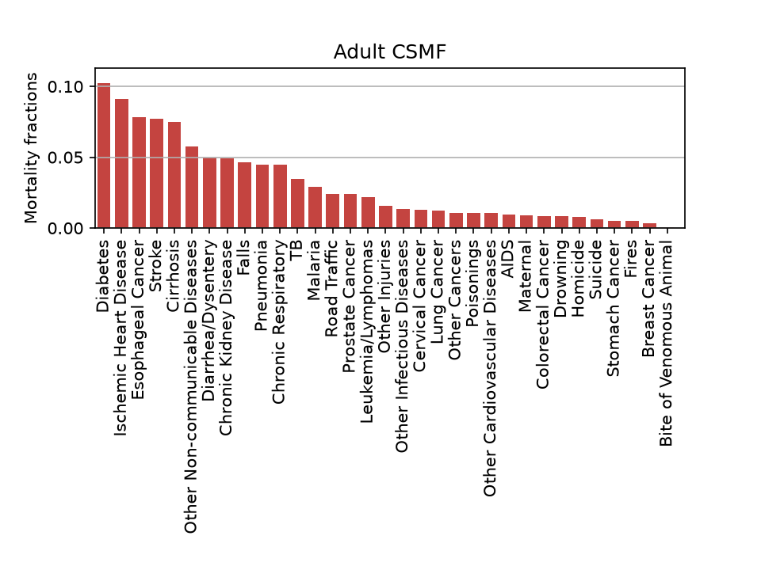 | 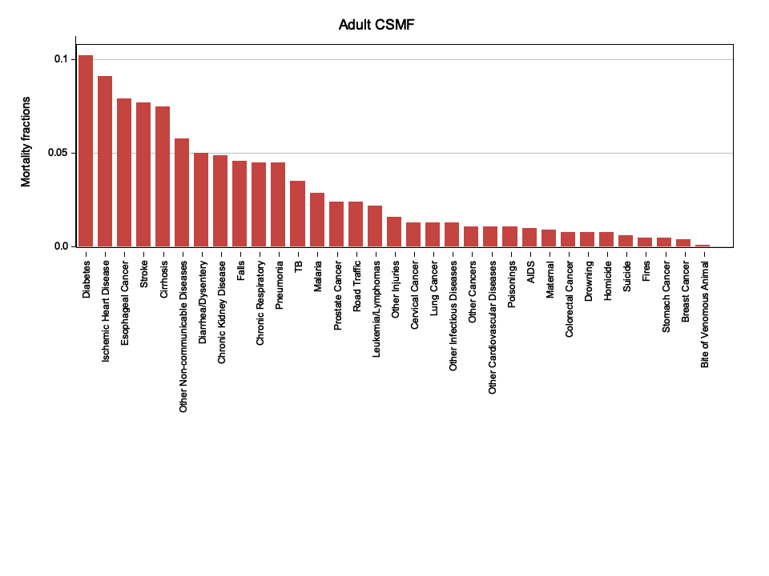 |
| **Adult Female CSMF Bar Chart (`adult-female-csmf-figure.png`)** [Python PNG](./evidence/charts/Cohort-01/python/adult-female-csmf-figure.png) · [Rust PNG](./evidence/charts/Cohort-01/rust/adult-female-csmf-figure.png) |  | 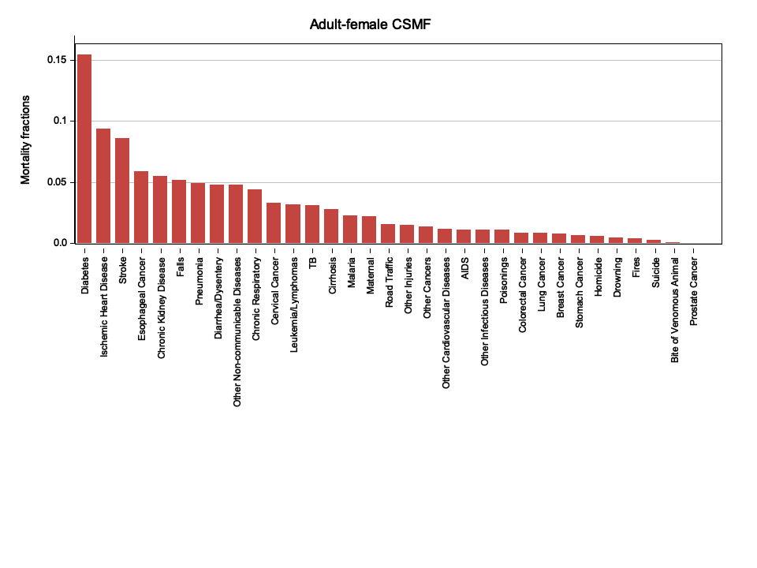 |
| **Adult Male CSMF Bar Chart (`adult-male-csmf-figure.png`)** [Python PNG](./evidence/charts/Cohort-01/python/adult-male-csmf-figure.png) · [Rust PNG](./evidence/charts/Cohort-01/rust/adult-male-csmf-figure.png) |  | 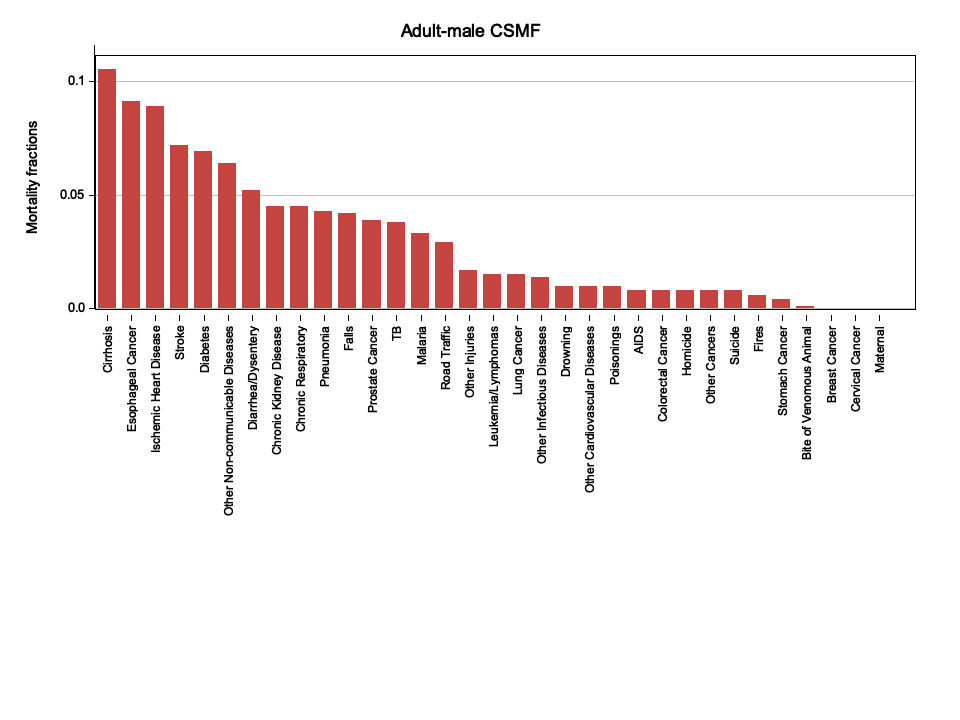 |
| **All-Age CSMF Bar Chart (`all-csmf-figure.png`)** [Python PNG](./evidence/charts/Cohort-01/python/all-csmf-figure.png) · [Rust PNG](./evidence/charts/Cohort-01/rust/all-csmf-figure.png) | 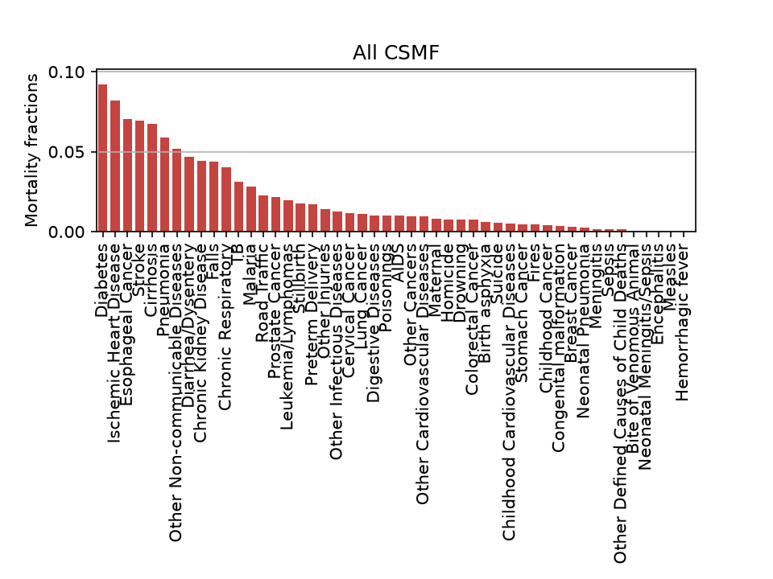 | 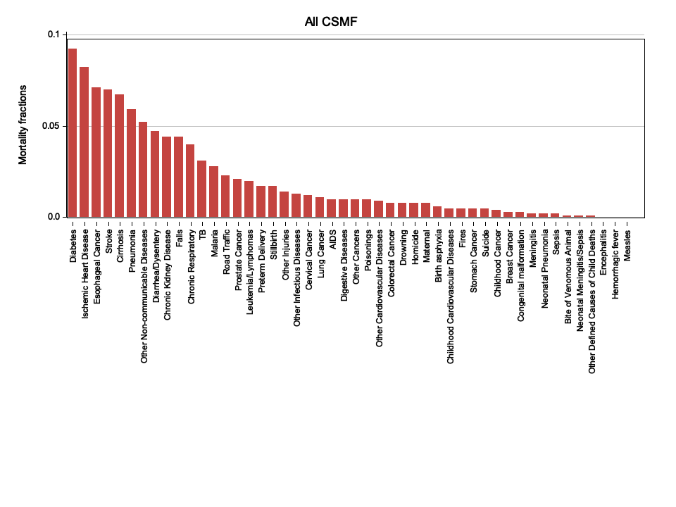 |
| **Age & Sex Distribution by Module (`all-figure.png`)** [Python PNG](./evidence/charts/Cohort-01/python/all-figure.png) · [Rust PNG](./evidence/charts/Cohort-01/rust/all-figure.png) | 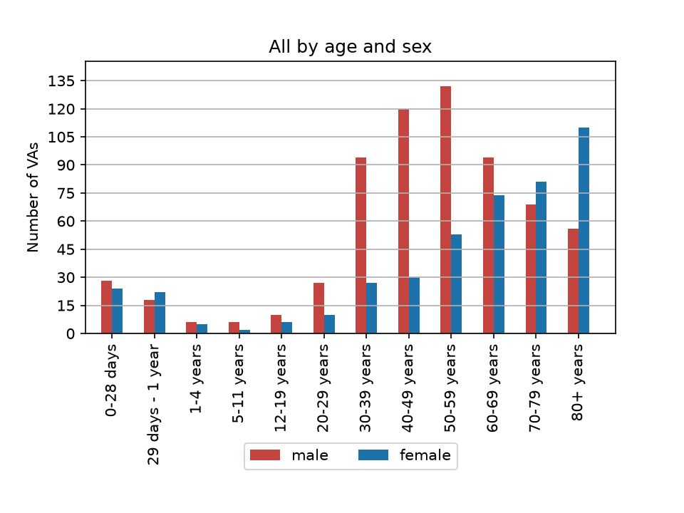 | 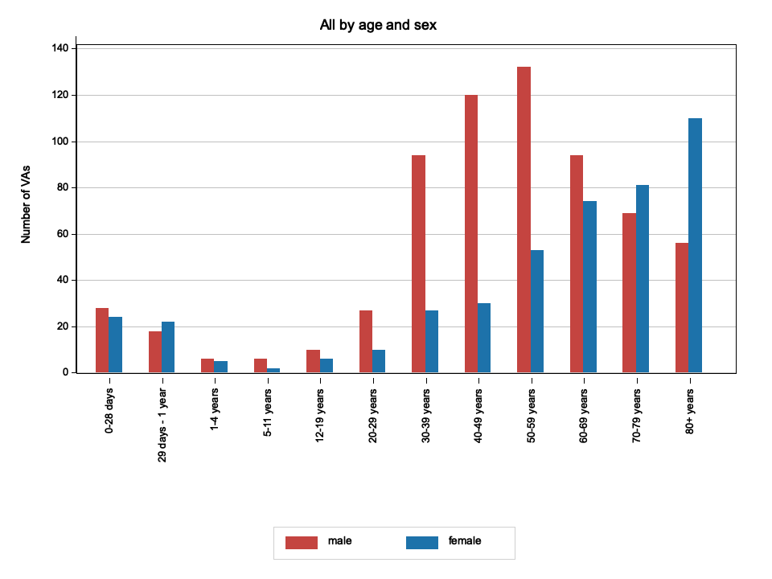 |
| **Child CSMF Bar Chart (`child-csmf-figure.png`)** [Python PNG](./evidence/charts/Cohort-01/python/child-csmf-figure.png) · [Rust PNG](./evidence/charts/Cohort-01/rust/child-csmf-figure.png) | 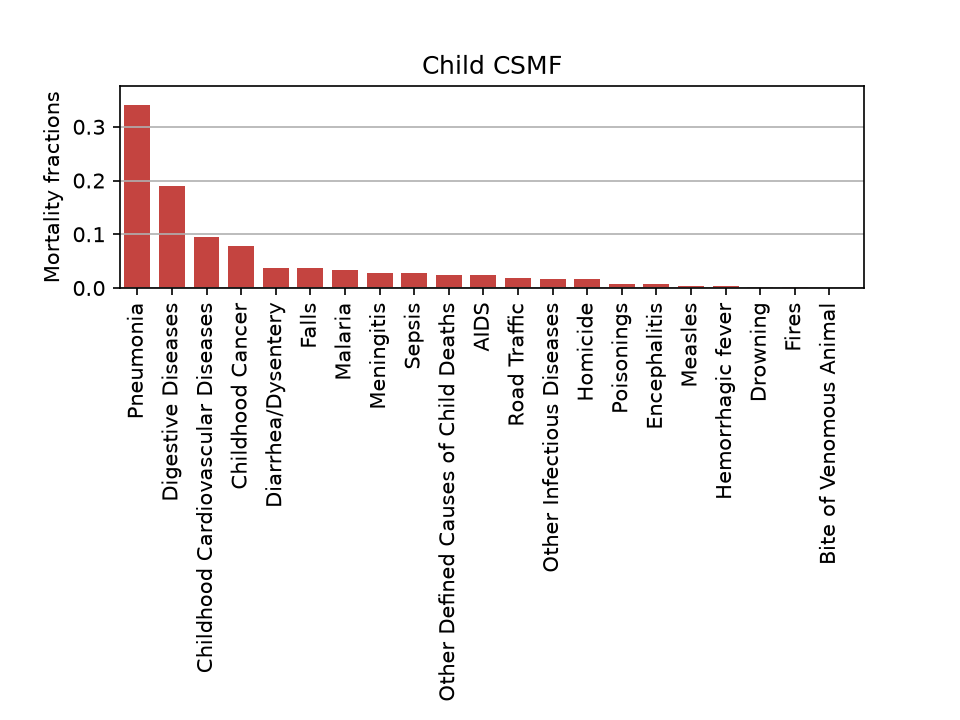 |  |
| **GBD Level-1 Cause Fractions Pie Chart (`gbd-level1-csmf.png`)** [Python PNG](./evidence/charts/Cohort-01/python/gbd-level1-csmf.png) · [Rust PNG](./evidence/charts/Cohort-01/rust/gbd-level1-csmf.png) | 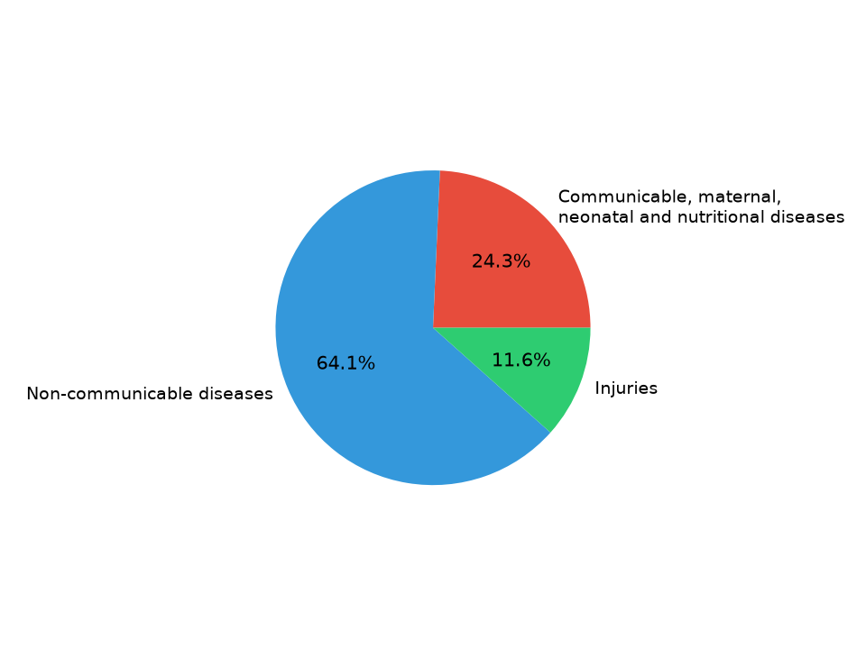 | 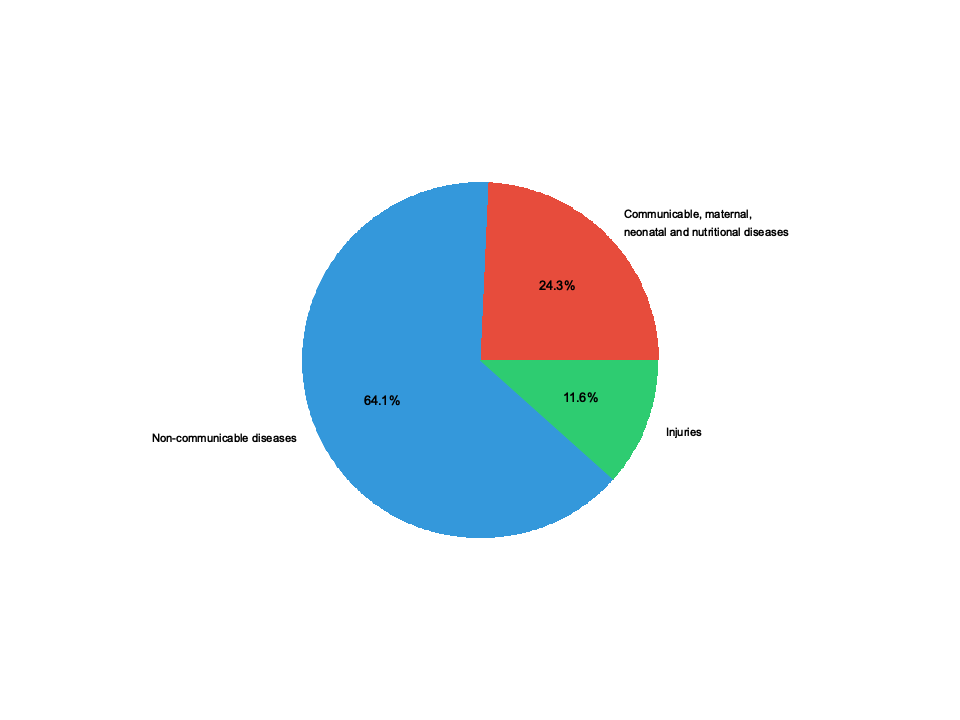 |
| **Neonate CSMF Bar Chart (`neonate-csmf-figure.png`)** [Python PNG](./evidence/charts/Cohort-01/python/neonate-csmf-figure.png) · [Rust PNG](./evidence/charts/Cohort-01/rust/neonate-csmf-figure.png) |  | 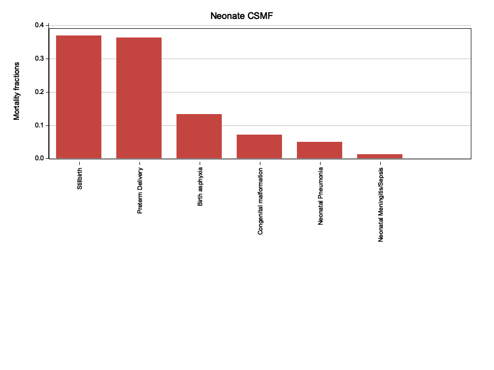 |
| **Undetermined COD Distribution (`undetermined-figure.png`)** [Python PNG](./evidence/charts/Cohort-01/python/undetermined-figure.png) · [Rust PNG](./evidence/charts/Cohort-01/rust/undetermined-figure.png) |  | 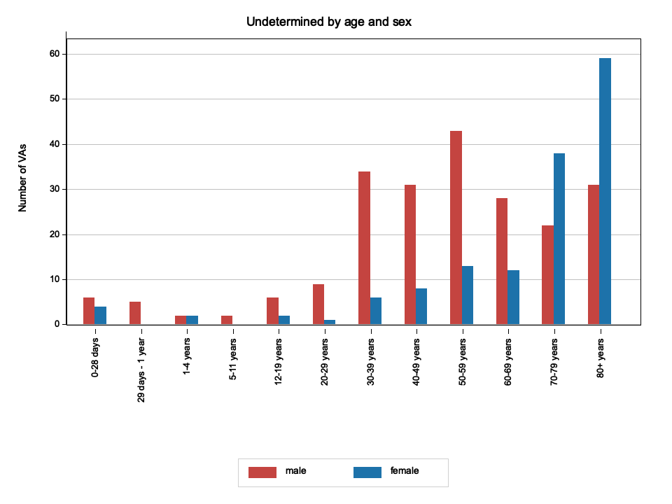 |

---

### Cohort-02

- **VAs Scored**: `1,077` | **`cause34` Parity**: `1,077 / 1,077` (`100.00%`) | **CSV Cell Diffs**: `0` | **Python**: `8112.2 ms` | **Rust Cold CLI**: `999.5 ms` (**`8.12x`**) | **Rust Warm FFI**: `842.0 ms` (**`9.63x`**)
- **Aggregate CSV Tabulations (`0` Python vs. Rust diffs)**: [`csmf.csv`](./evidence/tabulations/Cohort-02/csmf.csv) · [`gbd-level1-csmf.csv`](./evidence/tabulations/Cohort-02/gbd-level1-csmf.csv) · [`adult-csmf.csv`](./evidence/tabulations/Cohort-02/adult-csmf.csv) · [`child-csmf.csv`](./evidence/tabulations/Cohort-02/child-csmf.csv) · [`neonate-csmf.csv`](./evidence/tabulations/Cohort-02/neonate-csmf.csv) · [`causes-of-death.csv`](./evidence/tabulations/Cohort-02/causes-of-death.csv) · [`VA-data-age-groupings.csv`](./evidence/tabulations/Cohort-02/VA-data-age-groupings.csv) · [`adult-endorsement-rates.csv`](./evidence/tabulations/Cohort-02/adult-endorsement-rates.csv) · [`child-endorsement-rates.csv`](./evidence/tabulations/Cohort-02/child-endorsement-rates.csv) · [`neonate-endorsement-rates.csv`](./evidence/tabulations/Cohort-02/neonate-endorsement-rates.csv)

#### Aggregate CSMF Summary (`gbd-level1-csmf.csv` & Top Causes in `csmf.csv`)

| GBD Level-1 Category | CSMF | | Top All-Age Cause (`cause34`) | ICD-10 | All | Male | Female |
| --- | ---: | --- | --- | :---: | ---: | ---: | ---: |
| Communicable, maternal, neonatal and nutritional diseases (`A`) | `0.204` | | Ischemic Heart Disease | `I24` | `0.153` | `0.174` | `0.113` |
| Non-communicable diseases (`B`) | `0.551` | | Road Traffic | `V89` | `0.097` | `0.123` | `0.046` |
| Injuries (`C`) | `0.245` | | Diabetes | `E14` | `0.078` | `0.057` | `0.118` |
| | | | Stroke | `I64` | `0.058` | `0.065` | `0.046` |
| | | | TB | `A16` | `0.056` | `0.062` | `0.045` |
| | | | Chronic Respiratory | `J44` | `0.05` | `0.046` | `0.058` |
| | | | Diarrhea/Dysentery | `A09` | `0.05` | `0.038` | `0.072` |
| | | | Other Non-communicable Diseases | `UU1` | `0.037` | `0.035` | `0.042` |

#### Side-by-Side CSMF & Cohort Charts: Upstream Python (`matplotlib`) vs. Pure-Rust (`plotters`)

| Chart | Upstream Python (`matplotlib`) | Pure-Rust `smartva-rust` (`plotters`) |
| --- | :---: | :---: |
| **Adult CSMF Bar Chart (`adult-csmf-figure.png`)** [Python PNG](./evidence/charts/Cohort-02/python/adult-csmf-figure.png) · [Rust PNG](./evidence/charts/Cohort-02/rust/adult-csmf-figure.png) |  | 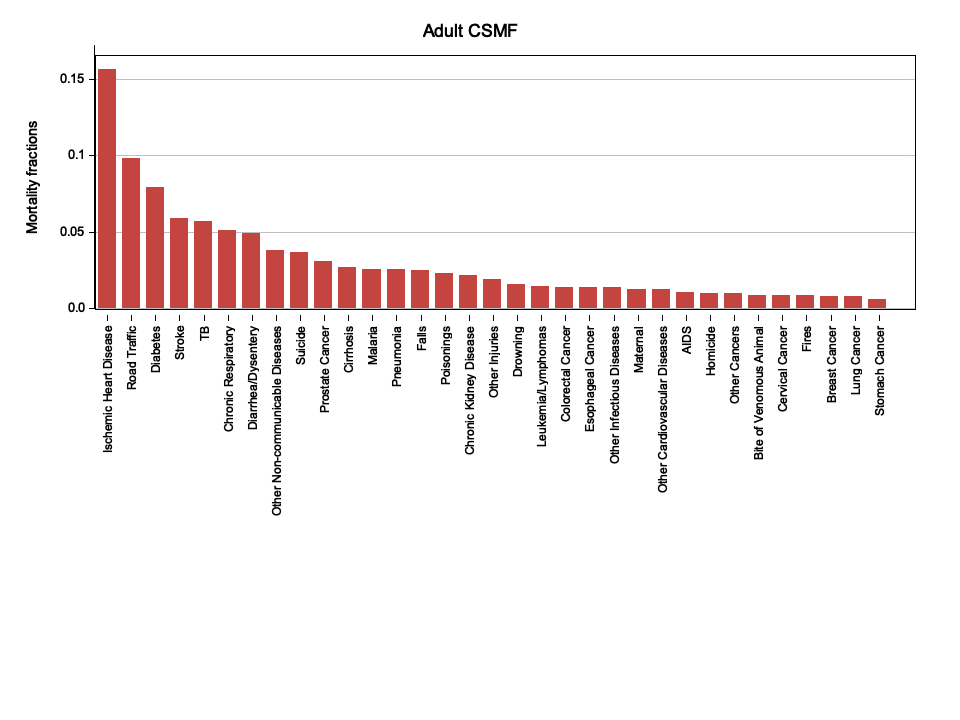 |
| **Adult Female CSMF Bar Chart (`adult-female-csmf-figure.png`)** [Python PNG](./evidence/charts/Cohort-02/python/adult-female-csmf-figure.png) · [Rust PNG](./evidence/charts/Cohort-02/rust/adult-female-csmf-figure.png) | 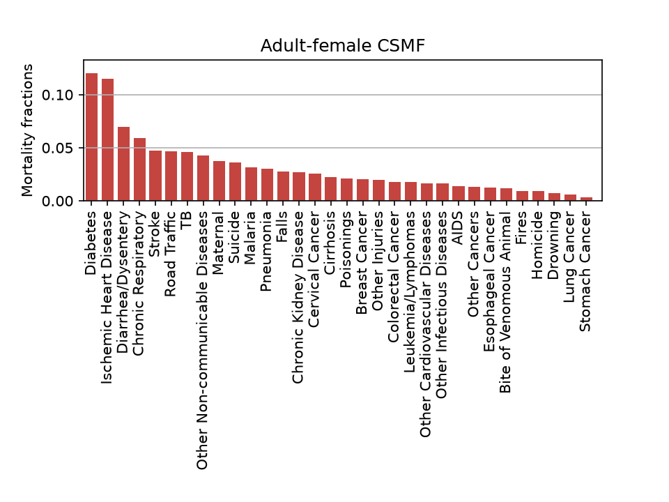 | 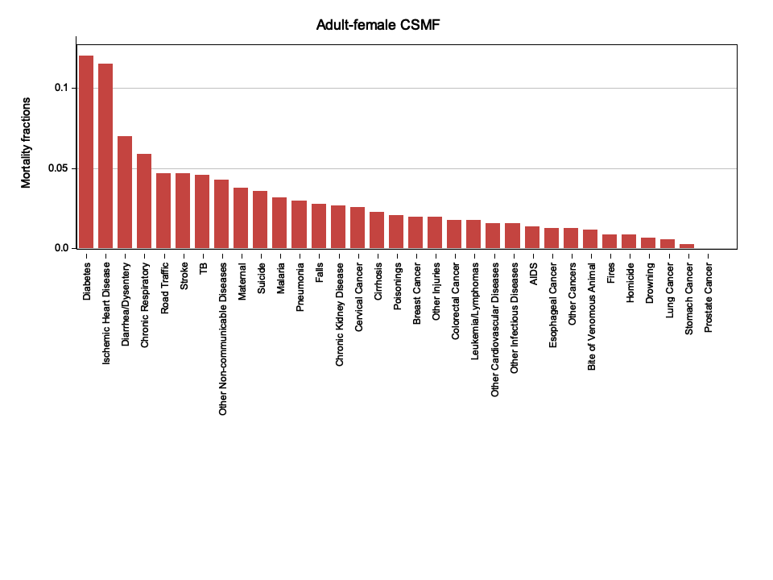 |
| **Adult Male CSMF Bar Chart (`adult-male-csmf-figure.png`)** [Python PNG](./evidence/charts/Cohort-02/python/adult-male-csmf-figure.png) · [Rust PNG](./evidence/charts/Cohort-02/rust/adult-male-csmf-figure.png) | 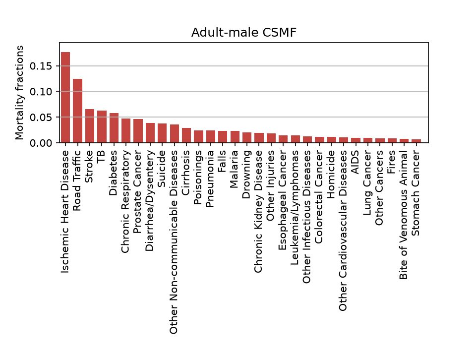 |  |
| **All-Age CSMF Bar Chart (`all-csmf-figure.png`)** [Python PNG](./evidence/charts/Cohort-02/python/all-csmf-figure.png) · [Rust PNG](./evidence/charts/Cohort-02/rust/all-csmf-figure.png) |  | 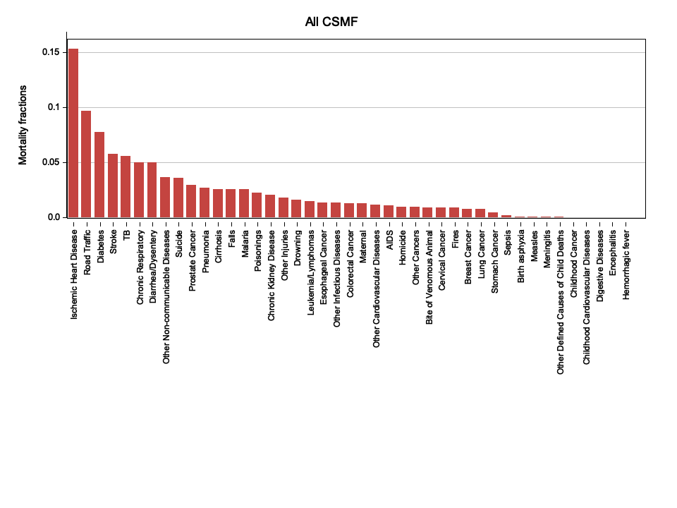 |
| **Age & Sex Distribution by Module (`all-figure.png`)** [Python PNG](./evidence/charts/Cohort-02/python/all-figure.png) · [Rust PNG](./evidence/charts/Cohort-02/rust/all-figure.png) |  | 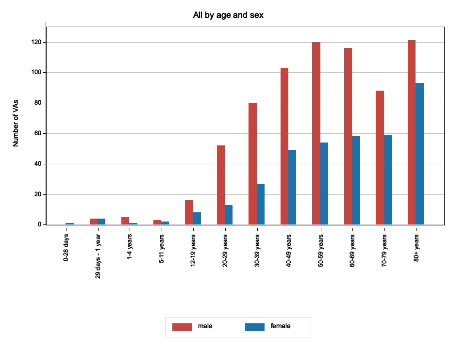 |
| **Child CSMF Bar Chart (`child-csmf-figure.png`)** [Python PNG](./evidence/charts/Cohort-02/python/child-csmf-figure.png) · [Rust PNG](./evidence/charts/Cohort-02/rust/child-csmf-figure.png) |  |  |
| **GBD Level-1 Cause Fractions Pie Chart (`gbd-level1-csmf.png`)** [Python PNG](./evidence/charts/Cohort-02/python/gbd-level1-csmf.png) · [Rust PNG](./evidence/charts/Cohort-02/rust/gbd-level1-csmf.png) | 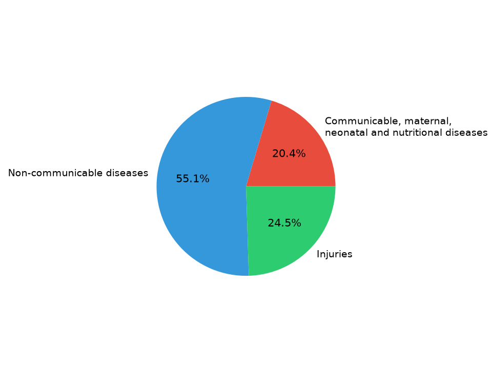 | 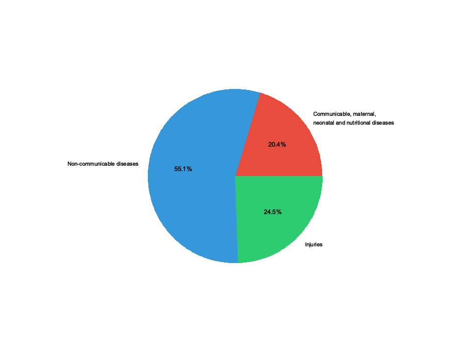 |
| **Neonate CSMF Bar Chart (`neonate-csmf-figure.png`)** [Python PNG](./evidence/charts/Cohort-02/python/neonate-csmf-figure.png) · [Rust PNG](./evidence/charts/Cohort-02/rust/neonate-csmf-figure.png) |  | 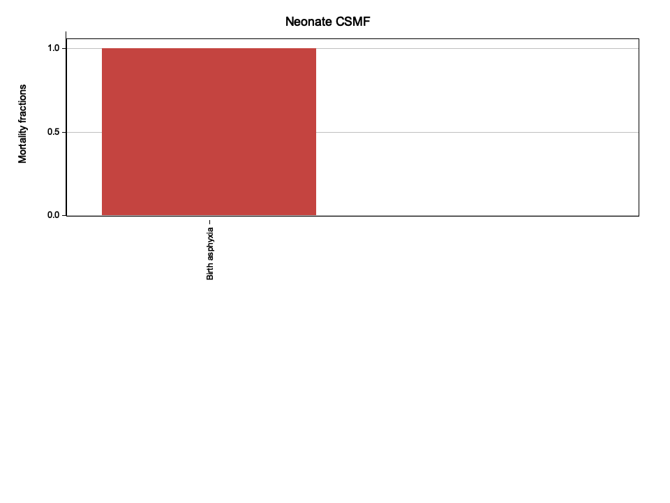 |
| **Undetermined COD Distribution (`undetermined-figure.png`)** [Python PNG](./evidence/charts/Cohort-02/python/undetermined-figure.png) · [Rust PNG](./evidence/charts/Cohort-02/rust/undetermined-figure.png) |  |  |

---

### Cohort-03

- **VAs Scored**: `116` | **`cause34` Parity**: `116 / 116` (`100.00%`) | **CSV Cell Diffs**: `0` | **Python**: `4174.7 ms` | **Rust Cold CLI**: `315.8 ms` (**`13.22x`**) | **Rust Warm FFI**: `151.5 ms` (**`27.55x`**)
- **Aggregate CSV Tabulations (`0` Python vs. Rust diffs)**: [`csmf.csv`](./evidence/tabulations/Cohort-03/csmf.csv) · [`gbd-level1-csmf.csv`](./evidence/tabulations/Cohort-03/gbd-level1-csmf.csv) · [`adult-csmf.csv`](./evidence/tabulations/Cohort-03/adult-csmf.csv) · [`child-csmf.csv`](./evidence/tabulations/Cohort-03/child-csmf.csv) · [`neonate-csmf.csv`](./evidence/tabulations/Cohort-03/neonate-csmf.csv) · [`causes-of-death.csv`](./evidence/tabulations/Cohort-03/causes-of-death.csv) · [`VA-data-age-groupings.csv`](./evidence/tabulations/Cohort-03/VA-data-age-groupings.csv) · [`adult-endorsement-rates.csv`](./evidence/tabulations/Cohort-03/adult-endorsement-rates.csv)

#### Aggregate CSMF Summary (`gbd-level1-csmf.csv` & Top Causes in `csmf.csv`)

| GBD Level-1 Category | CSMF | | Top All-Age Cause (`cause34`) | ICD-10 | All | Male | Female |
| --- | ---: | --- | --- | :---: | ---: | ---: | ---: |
| Communicable, maternal, neonatal and nutritional diseases (`A`) | `0.17` | | Ischemic Heart Disease | `I24` | `0.207` | `0.221` | `0.189` |
| Non-communicable diseases (`B`) | `0.737` | | Diabetes | `E14` | `0.105` | `0.024` | `0.212` |
| Injuries (`C`) | `0.093` | | Chronic Respiratory | `J44` | `0.1` | `0.11` | `0.087` |
| | | | Stroke | `I64` | `0.079` | `0.092` | `0.062` |
| | | | TB | `A16` | `0.071` | `0.088` | `0.049` |
| | | | Suicide | `X84` | `0.039` | `0.065` | `0.003` |
| | | | Lung Cancer | `C34` | `0.038` | `0.019` | `0.064` |
| | | | Prostate Cancer | `C61` | `0.037` | `0.064` | `0.0` |

#### Side-by-Side CSMF & Cohort Charts: Upstream Python (`matplotlib`) vs. Pure-Rust (`plotters`)

| Chart | Upstream Python (`matplotlib`) | Pure-Rust `smartva-rust` (`plotters`) |
| --- | :---: | :---: |
| **Adult CSMF Bar Chart (`adult-csmf-figure.png`)** [Python PNG](./evidence/charts/Cohort-03/python/adult-csmf-figure.png) · [Rust PNG](./evidence/charts/Cohort-03/rust/adult-csmf-figure.png) |  |  |
| **Adult Female CSMF Bar Chart (`adult-female-csmf-figure.png`)** [Python PNG](./evidence/charts/Cohort-03/python/adult-female-csmf-figure.png) · [Rust PNG](./evidence/charts/Cohort-03/rust/adult-female-csmf-figure.png) |  | 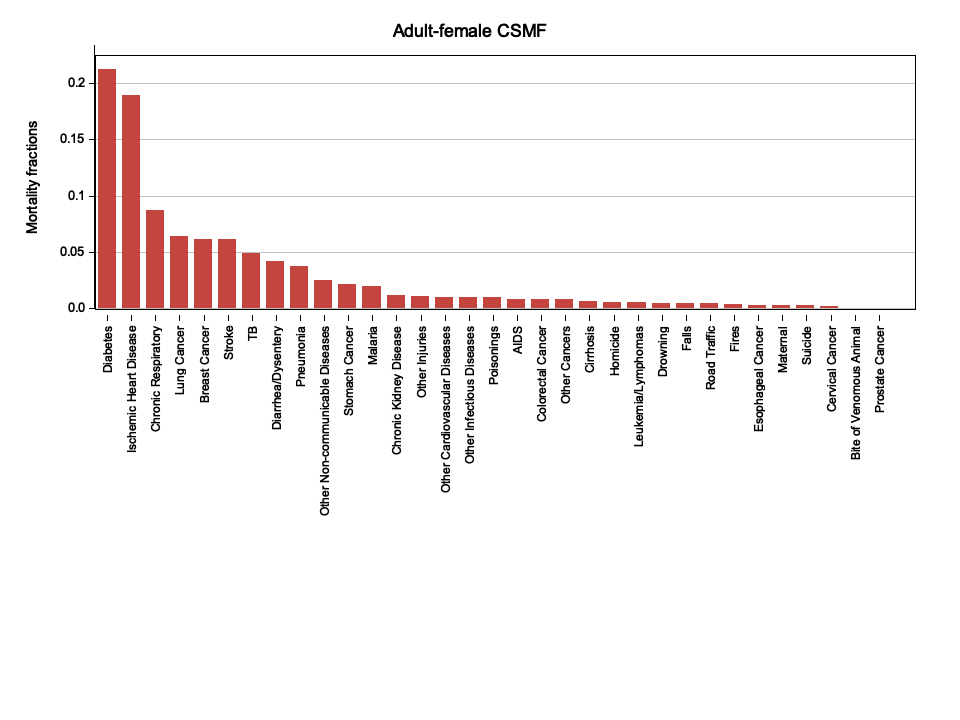 |
| **Adult Male CSMF Bar Chart (`adult-male-csmf-figure.png`)** [Python PNG](./evidence/charts/Cohort-03/python/adult-male-csmf-figure.png) · [Rust PNG](./evidence/charts/Cohort-03/rust/adult-male-csmf-figure.png) |  |  |
| **All-Age CSMF Bar Chart (`all-csmf-figure.png`)** [Python PNG](./evidence/charts/Cohort-03/python/all-csmf-figure.png) · [Rust PNG](./evidence/charts/Cohort-03/rust/all-csmf-figure.png) |  | 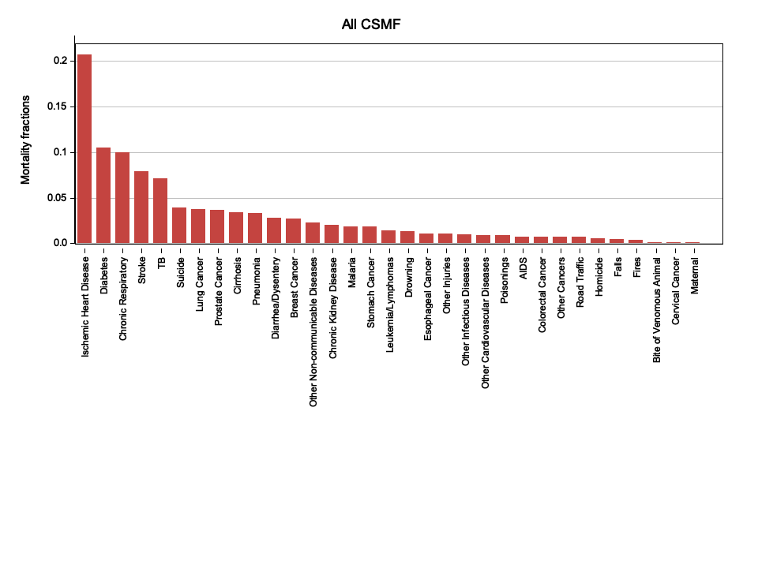 |
| **Age & Sex Distribution by Module (`all-figure.png`)** [Python PNG](./evidence/charts/Cohort-03/python/all-figure.png) · [Rust PNG](./evidence/charts/Cohort-03/rust/all-figure.png) |  |  |
| **GBD Level-1 Cause Fractions Pie Chart (`gbd-level1-csmf.png`)** [Python PNG](./evidence/charts/Cohort-03/python/gbd-level1-csmf.png) · [Rust PNG](./evidence/charts/Cohort-03/rust/gbd-level1-csmf.png) |  |  |
| **Undetermined COD Distribution (`undetermined-figure.png`)** [Python PNG](./evidence/charts/Cohort-03/python/undetermined-figure.png) · [Rust PNG](./evidence/charts/Cohort-03/rust/undetermined-figure.png) |  | 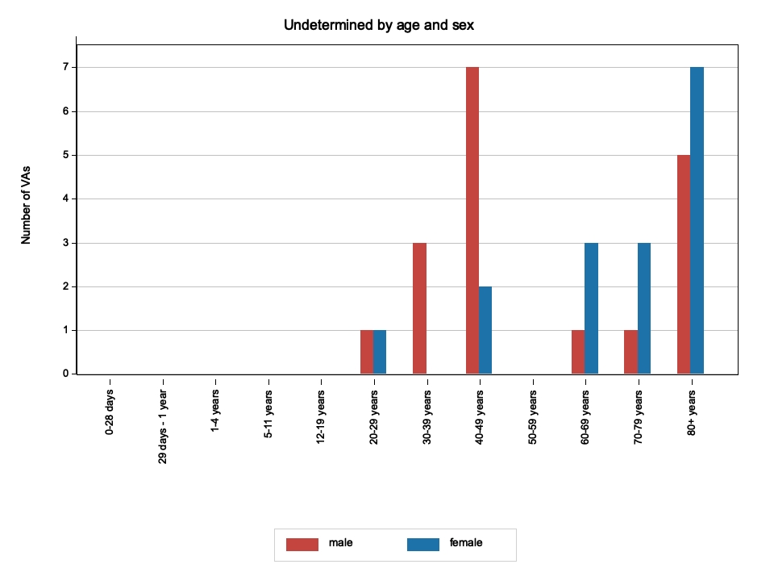 |

---

### Cohort-04

- **VAs Scored**: `820` | **`cause34` Parity**: `820 / 820` (`100.00%`) | **CSV Cell Diffs**: `0` | **Python**: `7392.8 ms` | **Rust Cold CLI**: `808.4 ms` (**`9.15x`**) | **Rust Warm FFI**: `628.2 ms` (**`11.77x`**)
- **Aggregate CSV Tabulations (`0` Python vs. Rust diffs)**: [`csmf.csv`](./evidence/tabulations/Cohort-04/csmf.csv) · [`gbd-level1-csmf.csv`](./evidence/tabulations/Cohort-04/gbd-level1-csmf.csv) · [`adult-csmf.csv`](./evidence/tabulations/Cohort-04/adult-csmf.csv) · [`child-csmf.csv`](./evidence/tabulations/Cohort-04/child-csmf.csv) · [`neonate-csmf.csv`](./evidence/tabulations/Cohort-04/neonate-csmf.csv) · [`causes-of-death.csv`](./evidence/tabulations/Cohort-04/causes-of-death.csv) · [`VA-data-age-groupings.csv`](./evidence/tabulations/Cohort-04/VA-data-age-groupings.csv) · [`adult-endorsement-rates.csv`](./evidence/tabulations/Cohort-04/adult-endorsement-rates.csv) · [`child-endorsement-rates.csv`](./evidence/tabulations/Cohort-04/child-endorsement-rates.csv) · [`neonate-endorsement-rates.csv`](./evidence/tabulations/Cohort-04/neonate-endorsement-rates.csv)

#### Aggregate CSMF Summary (`gbd-level1-csmf.csv` & Top Causes in `csmf.csv`)

| GBD Level-1 Category | CSMF | | Top All-Age Cause (`cause34`) | ICD-10 | All | Male | Female |
| --- | ---: | --- | --- | :---: | ---: | ---: | ---: |
| Communicable, maternal, neonatal and nutritional diseases (`A`) | `0.242` | | Ischemic Heart Disease | `I24` | `0.177` | `0.193` | `0.152` |
| Non-communicable diseases (`B`) | `0.622` | | Diabetes | `E14` | `0.097` | `0.077` | `0.13` |
| Injuries (`C`) | `0.135` | | Stroke | `I64` | `0.087` | `0.079` | `0.102` |
| | | | TB | `A16` | `0.077` | `0.086` | `0.062` |
| | | | Chronic Respiratory | `J44` | `0.061` | `0.06` | `0.063` |
| | | | Pneumonia | `J22` | `0.044` | `0.046` | `0.044` |
| | | | Diarrhea/Dysentery | `A09` | `0.042` | `0.038` | `0.049` |
| | | | Prostate Cancer | `C61` | `0.04` | `0.065` | `0.0` |

#### Side-by-Side CSMF & Cohort Charts: Upstream Python (`matplotlib`) vs. Pure-Rust (`plotters`)

| Chart | Upstream Python (`matplotlib`) | Pure-Rust `smartva-rust` (`plotters`) |
| --- | :---: | :---: |
| **Adult CSMF Bar Chart (`adult-csmf-figure.png`)** [Python PNG](./evidence/charts/Cohort-04/python/adult-csmf-figure.png) · [Rust PNG](./evidence/charts/Cohort-04/rust/adult-csmf-figure.png) | 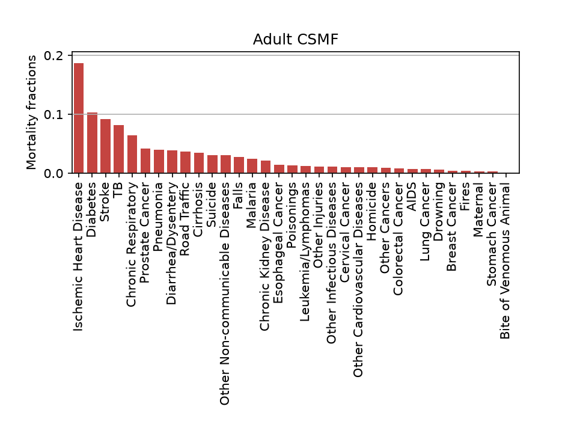 | 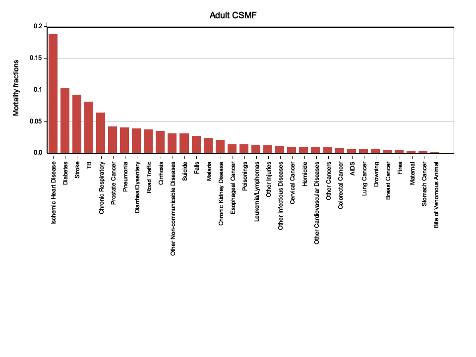 |
| **Adult Female CSMF Bar Chart (`adult-female-csmf-figure.png`)** [Python PNG](./evidence/charts/Cohort-04/python/adult-female-csmf-figure.png) · [Rust PNG](./evidence/charts/Cohort-04/rust/adult-female-csmf-figure.png) |  | 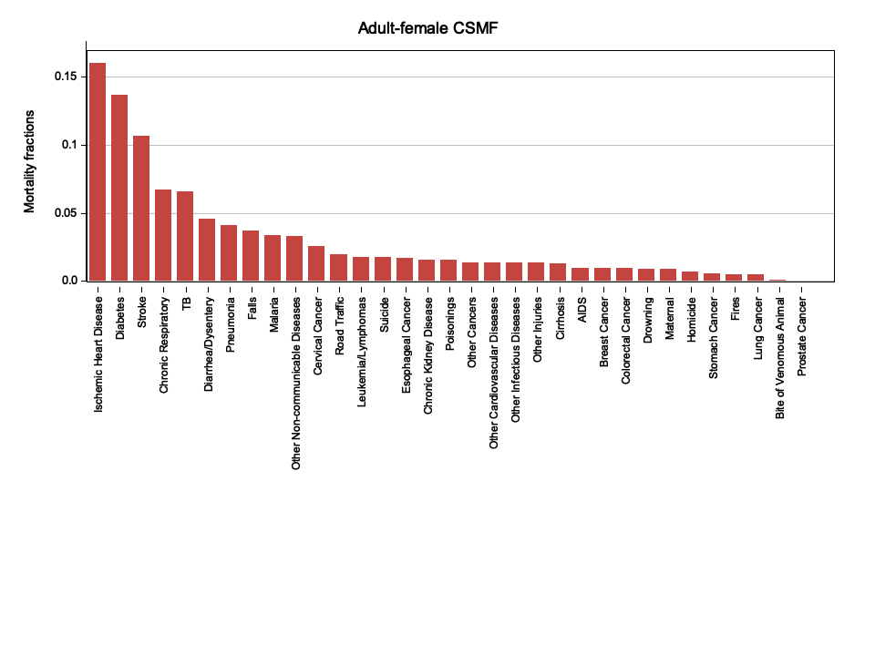 |
| **Adult Male CSMF Bar Chart (`adult-male-csmf-figure.png`)** [Python PNG](./evidence/charts/Cohort-04/python/adult-male-csmf-figure.png) · [Rust PNG](./evidence/charts/Cohort-04/rust/adult-male-csmf-figure.png) |  |  |
| **All-Age CSMF Bar Chart (`all-csmf-figure.png`)** [Python PNG](./evidence/charts/Cohort-04/python/all-csmf-figure.png) · [Rust PNG](./evidence/charts/Cohort-04/rust/all-csmf-figure.png) | 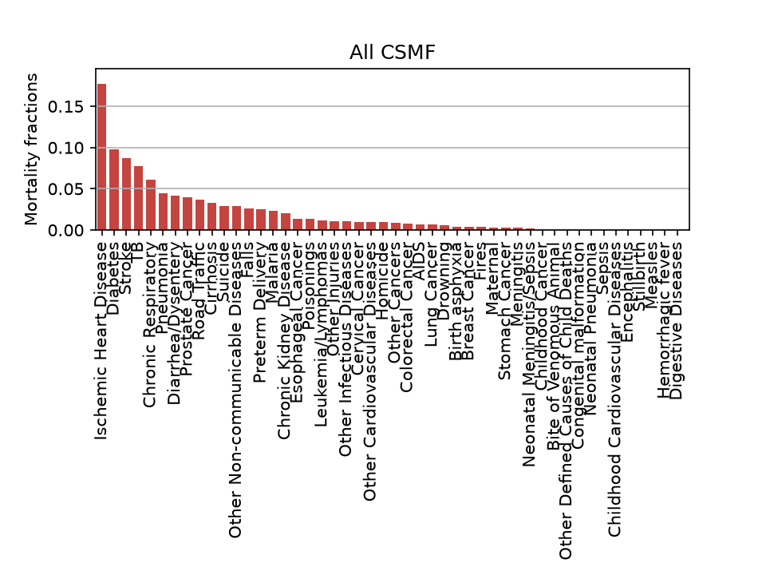 |  |
| **Age & Sex Distribution by Module (`all-figure.png`)** [Python PNG](./evidence/charts/Cohort-04/python/all-figure.png) · [Rust PNG](./evidence/charts/Cohort-04/rust/all-figure.png) |  | 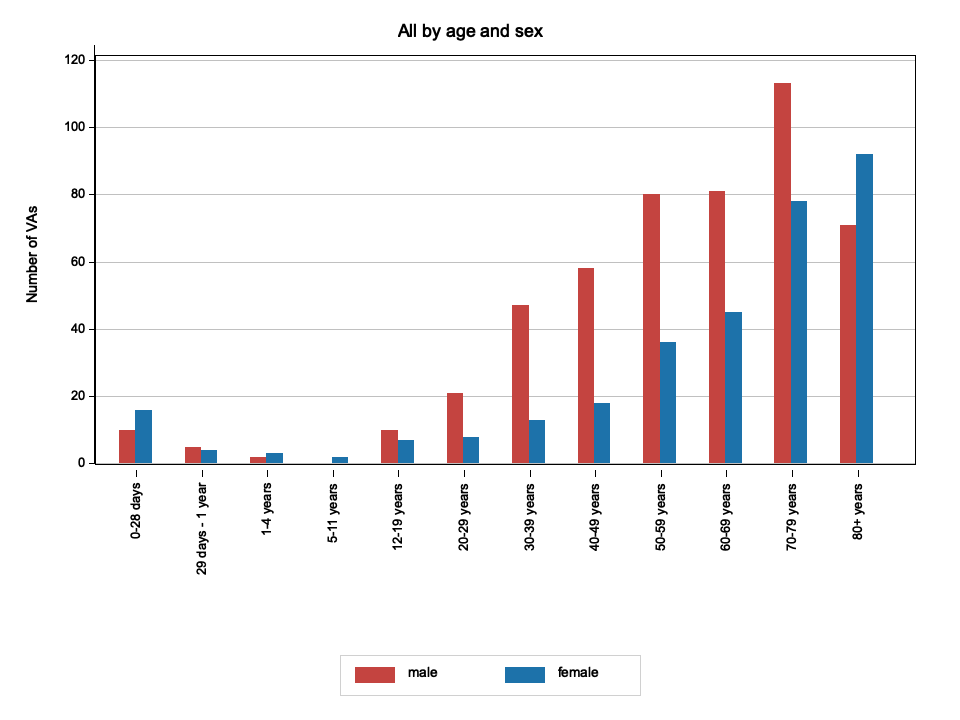 |
| **Child CSMF Bar Chart (`child-csmf-figure.png`)** [Python PNG](./evidence/charts/Cohort-04/python/child-csmf-figure.png) · [Rust PNG](./evidence/charts/Cohort-04/rust/child-csmf-figure.png) |  | 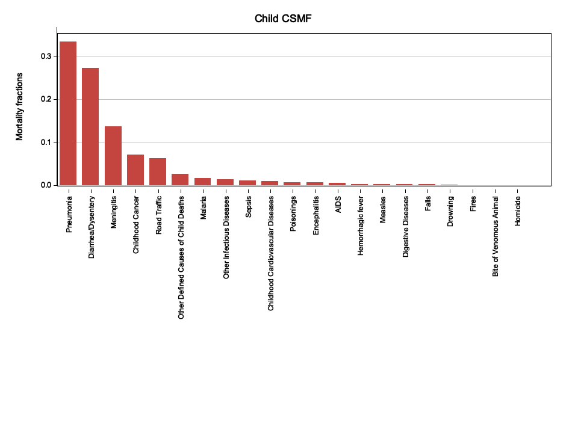 |
| **GBD Level-1 Cause Fractions Pie Chart (`gbd-level1-csmf.png`)** [Python PNG](./evidence/charts/Cohort-04/python/gbd-level1-csmf.png) · [Rust PNG](./evidence/charts/Cohort-04/rust/gbd-level1-csmf.png) | 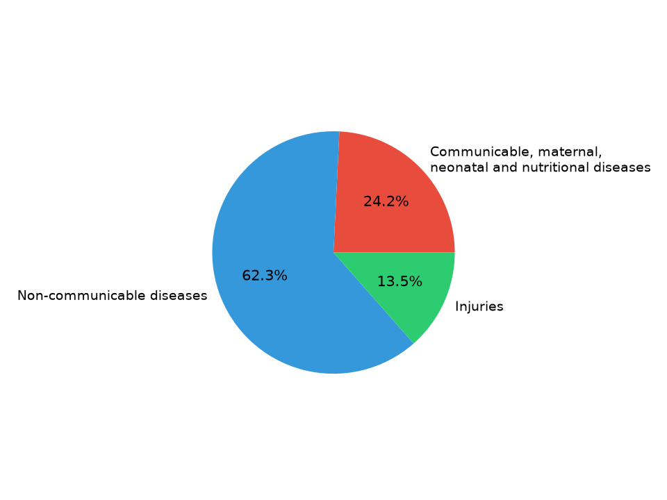 |  |
| **Neonate CSMF Bar Chart (`neonate-csmf-figure.png`)** [Python PNG](./evidence/charts/Cohort-04/python/neonate-csmf-figure.png) · [Rust PNG](./evidence/charts/Cohort-04/rust/neonate-csmf-figure.png) |  |  |
| **Undetermined COD Distribution (`undetermined-figure.png`)** [Python PNG](./evidence/charts/Cohort-04/python/undetermined-figure.png) · [Rust PNG](./evidence/charts/Cohort-04/rust/undetermined-figure.png) |  |  |

---

### Cohort-05

- **VAs Scored**: `1,258` | **`cause34` Parity**: `1,258 / 1,258` (`100.00%`) | **CSV Cell Diffs**: `0` | **Python**: `8039.5 ms` | **Rust Cold CLI**: `1129.1 ms` (**`7.12x`**) | **Rust Warm FFI**: `958.5 ms` (**`8.39x`**)
- **Aggregate CSV Tabulations (`0` Python vs. Rust diffs)**: [`csmf.csv`](./evidence/tabulations/Cohort-05/csmf.csv) · [`gbd-level1-csmf.csv`](./evidence/tabulations/Cohort-05/gbd-level1-csmf.csv) · [`adult-csmf.csv`](./evidence/tabulations/Cohort-05/adult-csmf.csv) · [`child-csmf.csv`](./evidence/tabulations/Cohort-05/child-csmf.csv) · [`neonate-csmf.csv`](./evidence/tabulations/Cohort-05/neonate-csmf.csv) · [`causes-of-death.csv`](./evidence/tabulations/Cohort-05/causes-of-death.csv) · [`VA-data-age-groupings.csv`](./evidence/tabulations/Cohort-05/VA-data-age-groupings.csv) · [`adult-endorsement-rates.csv`](./evidence/tabulations/Cohort-05/adult-endorsement-rates.csv) · [`child-endorsement-rates.csv`](./evidence/tabulations/Cohort-05/child-endorsement-rates.csv)

#### Aggregate CSMF Summary (`gbd-level1-csmf.csv` & Top Causes in `csmf.csv`)

| GBD Level-1 Category | CSMF | | Top All-Age Cause (`cause34`) | ICD-10 | All | Male | Female |
| --- | ---: | --- | --- | :---: | ---: | ---: | ---: |
| Communicable, maternal, neonatal and nutritional diseases (`A`) | `0.185` | | Diabetes | `E14` | `0.165` | `0.163` | `0.167` |
| Non-communicable diseases (`B`) | `0.687` | | Ischemic Heart Disease | `I24` | `0.111` | `0.133` | `0.088` |
| Injuries (`C`) | `0.128` | | Stroke | `I64` | `0.107` | `0.096` | `0.118` |
| | | | Chronic Respiratory | `J44` | `0.105` | `0.092` | `0.119` |
| | | | Diarrhea/Dysentery | `A09` | `0.054` | `0.044` | `0.065` |
| | | | TB | `A16` | `0.054` | `0.07` | `0.037` |
| | | | Falls | `W19` | `0.051` | `0.033` | `0.07` |
| | | | Other Non-communicable Diseases | `UU1` | `0.042` | `0.04` | `0.043` |

#### Side-by-Side CSMF & Cohort Charts: Upstream Python (`matplotlib`) vs. Pure-Rust (`plotters`)

| Chart | Upstream Python (`matplotlib`) | Pure-Rust `smartva-rust` (`plotters`) |
| --- | :---: | :---: |
| **Adult CSMF Bar Chart (`adult-csmf-figure.png`)** [Python PNG](./evidence/charts/Cohort-05/python/adult-csmf-figure.png) · [Rust PNG](./evidence/charts/Cohort-05/rust/adult-csmf-figure.png) |  |  |
| **Adult Female CSMF Bar Chart (`adult-female-csmf-figure.png`)** [Python PNG](./evidence/charts/Cohort-05/python/adult-female-csmf-figure.png) · [Rust PNG](./evidence/charts/Cohort-05/rust/adult-female-csmf-figure.png) | 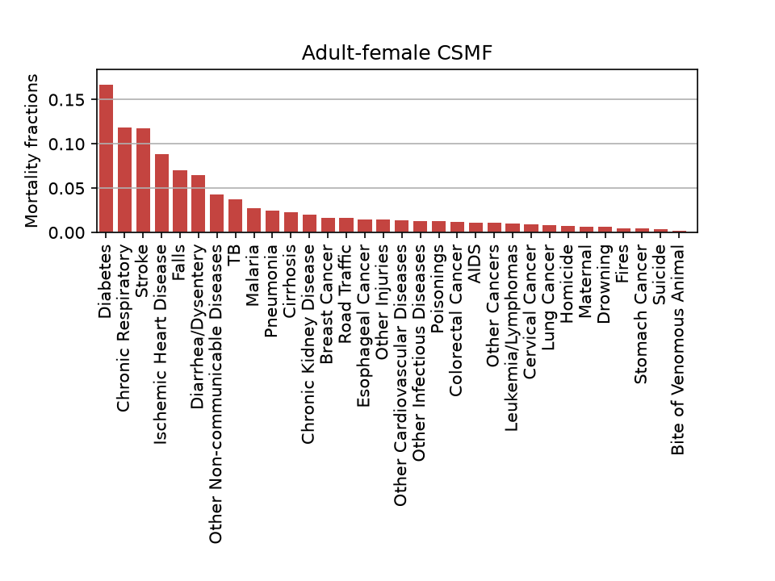 |  |
| **Adult Male CSMF Bar Chart (`adult-male-csmf-figure.png`)** [Python PNG](./evidence/charts/Cohort-05/python/adult-male-csmf-figure.png) · [Rust PNG](./evidence/charts/Cohort-05/rust/adult-male-csmf-figure.png) |  |  |
| **All-Age CSMF Bar Chart (`all-csmf-figure.png`)** [Python PNG](./evidence/charts/Cohort-05/python/all-csmf-figure.png) · [Rust PNG](./evidence/charts/Cohort-05/rust/all-csmf-figure.png) | 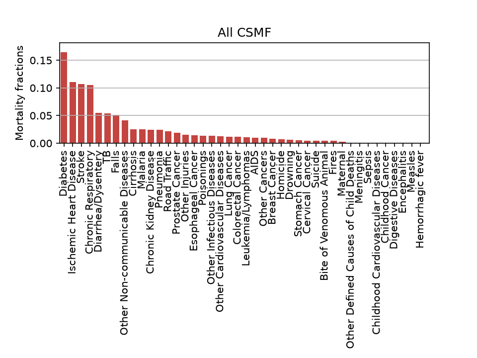 |  |
| **Age & Sex Distribution by Module (`all-figure.png`)** [Python PNG](./evidence/charts/Cohort-05/python/all-figure.png) · [Rust PNG](./evidence/charts/Cohort-05/rust/all-figure.png) |  |  |
| **Child CSMF Bar Chart (`child-csmf-figure.png`)** [Python PNG](./evidence/charts/Cohort-05/python/child-csmf-figure.png) · [Rust PNG](./evidence/charts/Cohort-05/rust/child-csmf-figure.png) | 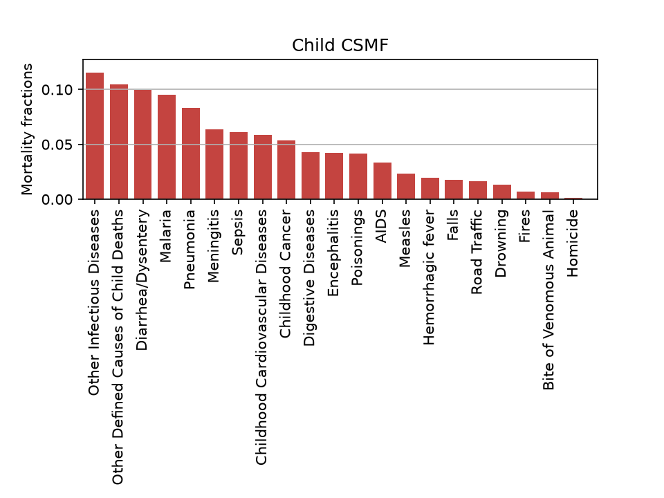 | 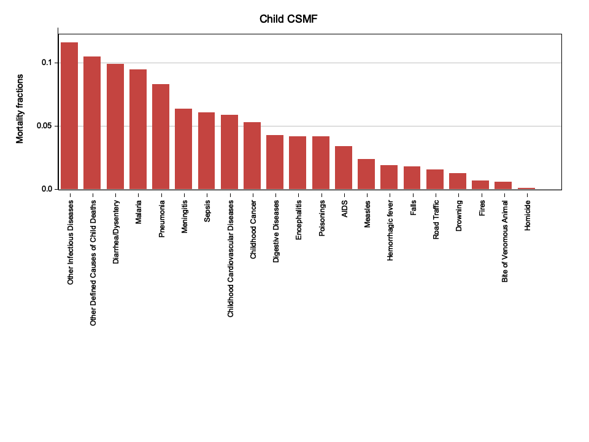 |
| **GBD Level-1 Cause Fractions Pie Chart (`gbd-level1-csmf.png`)** [Python PNG](./evidence/charts/Cohort-05/python/gbd-level1-csmf.png) · [Rust PNG](./evidence/charts/Cohort-05/rust/gbd-level1-csmf.png) |  | 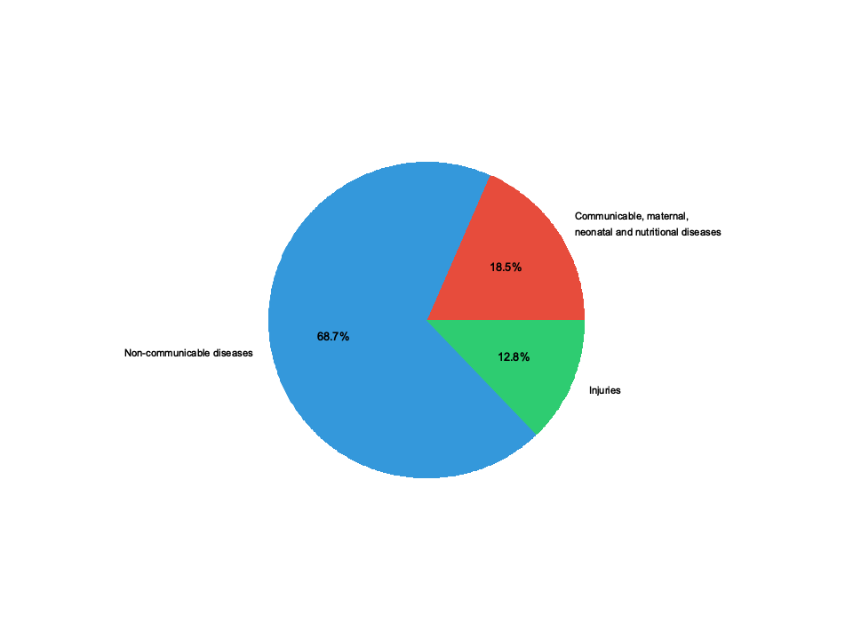 |
| **Undetermined COD Distribution (`undetermined-figure.png`)** [Python PNG](./evidence/charts/Cohort-05/python/undetermined-figure.png) · [Rust PNG](./evidence/charts/Cohort-05/rust/undetermined-figure.png) | 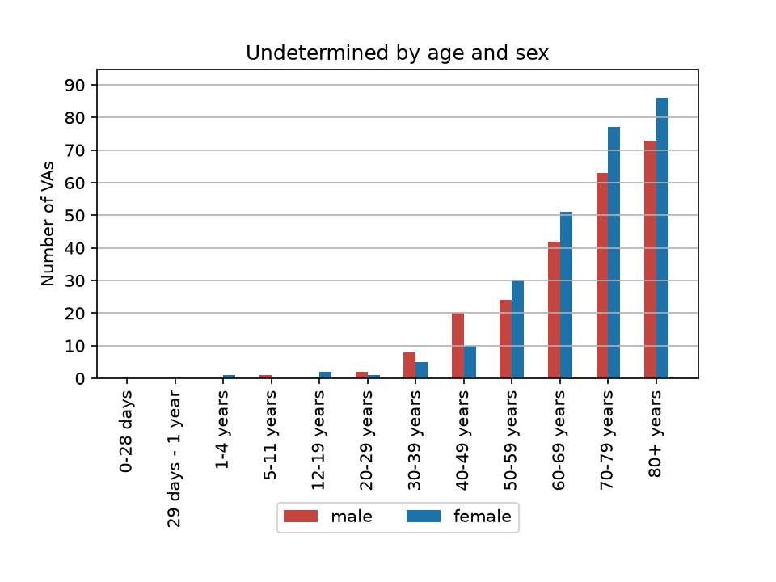 |  |

---

### Cohort-06

- **VAs Scored**: `1,388` | **`cause34` Parity**: `1,388 / 1,388` (`100.00%`) | **CSV Cell Diffs**: `0` | **Python**: `8994.7 ms` | **Rust Cold CLI**: `1220.2 ms` (**`7.37x`**) | **Rust Warm FFI**: `1065.7 ms` (**`8.44x`**)
- **Aggregate CSV Tabulations (`0` Python vs. Rust diffs)**: [`csmf.csv`](./evidence/tabulations/Cohort-06/csmf.csv) · [`gbd-level1-csmf.csv`](./evidence/tabulations/Cohort-06/gbd-level1-csmf.csv) · [`adult-csmf.csv`](./evidence/tabulations/Cohort-06/adult-csmf.csv) · [`child-csmf.csv`](./evidence/tabulations/Cohort-06/child-csmf.csv) · [`neonate-csmf.csv`](./evidence/tabulations/Cohort-06/neonate-csmf.csv) · [`causes-of-death.csv`](./evidence/tabulations/Cohort-06/causes-of-death.csv) · [`VA-data-age-groupings.csv`](./evidence/tabulations/Cohort-06/VA-data-age-groupings.csv) · [`adult-endorsement-rates.csv`](./evidence/tabulations/Cohort-06/adult-endorsement-rates.csv) · [`child-endorsement-rates.csv`](./evidence/tabulations/Cohort-06/child-endorsement-rates.csv)

#### Aggregate CSMF Summary (`gbd-level1-csmf.csv` & Top Causes in `csmf.csv`)

| GBD Level-1 Category | CSMF | | Top All-Age Cause (`cause34`) | ICD-10 | All | Male | Female |
| --- | ---: | --- | --- | :---: | ---: | ---: | ---: |
| Communicable, maternal, neonatal and nutritional diseases (`A`) | `0.137` | | Ischemic Heart Disease | `I24` | `0.185` | `0.185` | `0.185` |
| Non-communicable diseases (`B`) | `0.678` | | Diabetes | `E14` | `0.153` | `0.133` | `0.184` |
| Injuries (`C`) | `0.185` | | Stroke | `I64` | `0.079` | `0.081` | `0.075` |
| | | | Cirrhosis | `K74` | `0.053` | `0.08` | `0.01` |
| | | | Falls | `W19` | `0.053` | `0.049` | `0.061` |
| | | | Road Traffic | `V89` | `0.053` | `0.07` | `0.027` |
| | | | Chronic Respiratory | `J44` | `0.04` | `0.037` | `0.045` |
| | | | Chronic Kidney Disease | `N18` | `0.039` | `0.034` | `0.048` |

#### Side-by-Side CSMF & Cohort Charts: Upstream Python (`matplotlib`) vs. Pure-Rust (`plotters`)

| Chart | Upstream Python (`matplotlib`) | Pure-Rust `smartva-rust` (`plotters`) |
| --- | :---: | :---: |
| **Adult CSMF Bar Chart (`adult-csmf-figure.png`)** [Python PNG](./evidence/charts/Cohort-06/python/adult-csmf-figure.png) · [Rust PNG](./evidence/charts/Cohort-06/rust/adult-csmf-figure.png) | 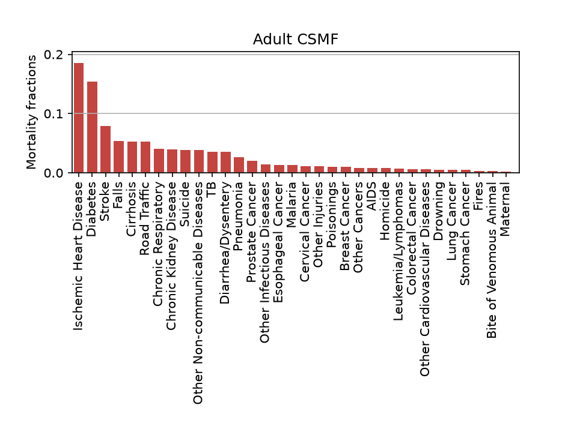 |  |
| **Adult Female CSMF Bar Chart (`adult-female-csmf-figure.png`)** [Python PNG](./evidence/charts/Cohort-06/python/adult-female-csmf-figure.png) · [Rust PNG](./evidence/charts/Cohort-06/rust/adult-female-csmf-figure.png) | 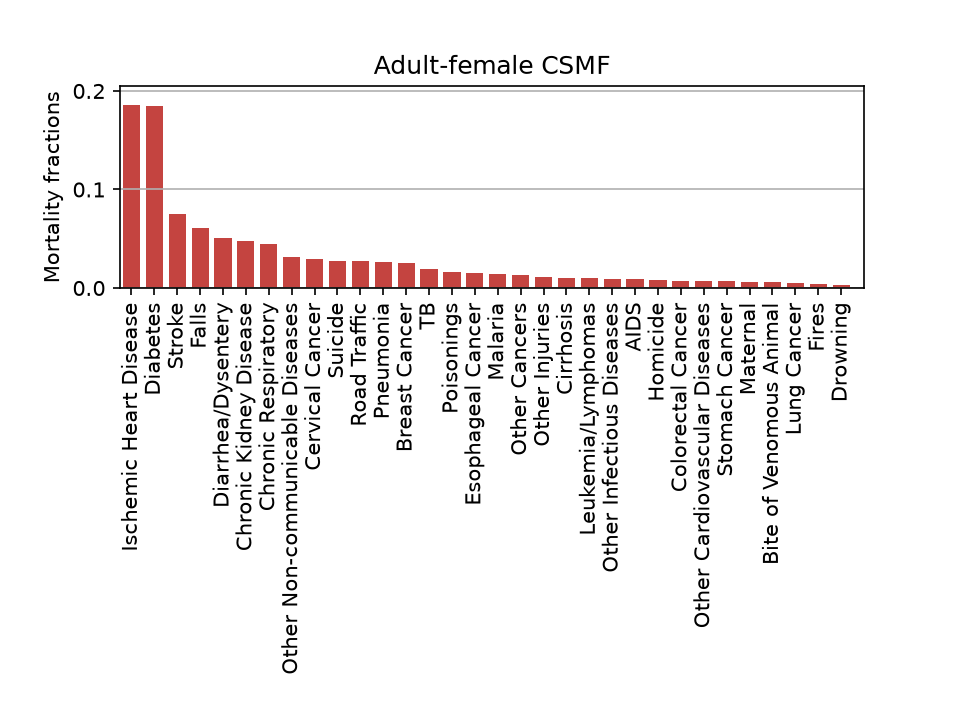 | 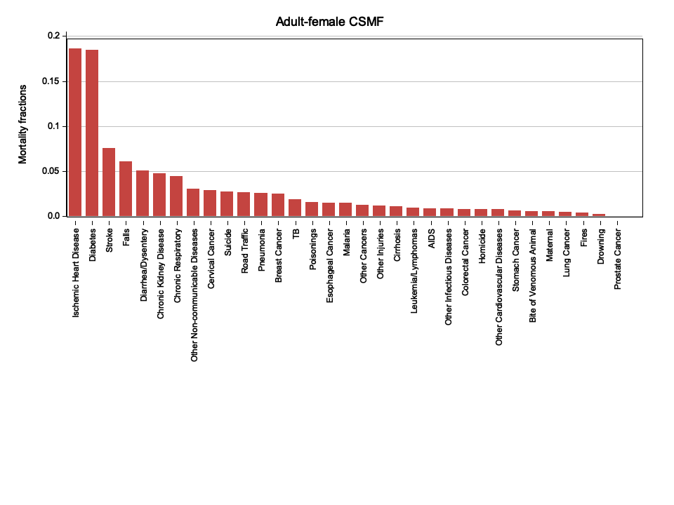 |
| **Adult Male CSMF Bar Chart (`adult-male-csmf-figure.png`)** [Python PNG](./evidence/charts/Cohort-06/python/adult-male-csmf-figure.png) · [Rust PNG](./evidence/charts/Cohort-06/rust/adult-male-csmf-figure.png) |  | 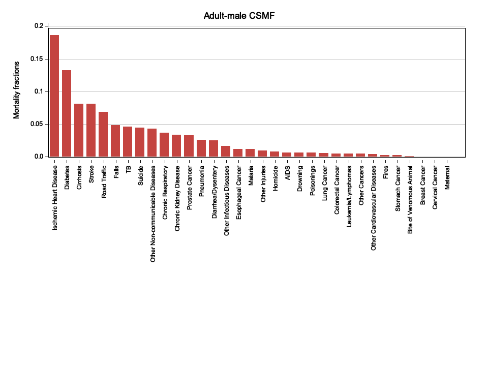 |
| **All-Age CSMF Bar Chart (`all-csmf-figure.png`)** [Python PNG](./evidence/charts/Cohort-06/python/all-csmf-figure.png) · [Rust PNG](./evidence/charts/Cohort-06/rust/all-csmf-figure.png) | 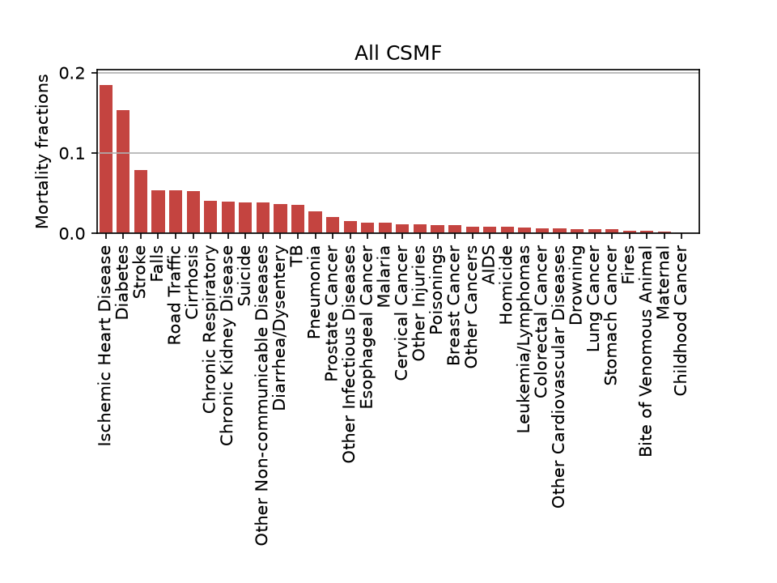 |  |
| **Age & Sex Distribution by Module (`all-figure.png`)** [Python PNG](./evidence/charts/Cohort-06/python/all-figure.png) · [Rust PNG](./evidence/charts/Cohort-06/rust/all-figure.png) | 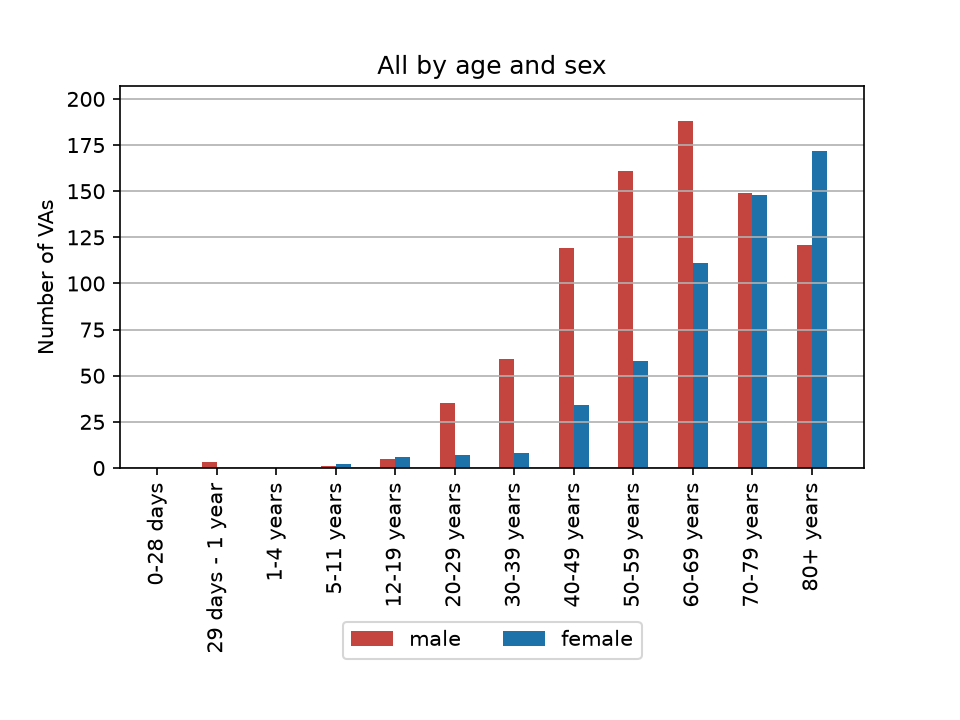 |  |
| **Child CSMF Bar Chart (`child-csmf-figure.png`)** [Python PNG](./evidence/charts/Cohort-06/python/child-csmf-figure.png) · [Rust PNG](./evidence/charts/Cohort-06/rust/child-csmf-figure.png) |  | 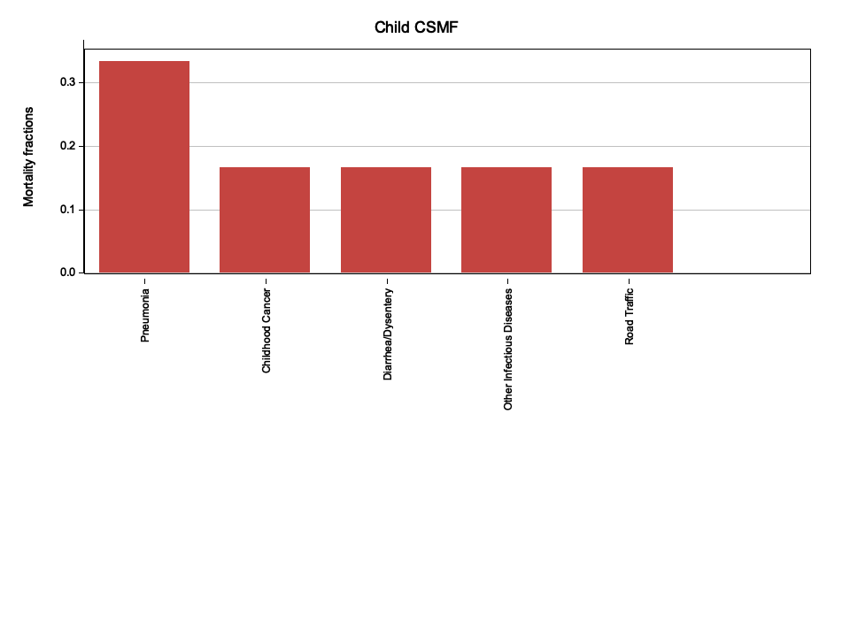 |
| **GBD Level-1 Cause Fractions Pie Chart (`gbd-level1-csmf.png`)** [Python PNG](./evidence/charts/Cohort-06/python/gbd-level1-csmf.png) · [Rust PNG](./evidence/charts/Cohort-06/rust/gbd-level1-csmf.png) |  |  |
| **Undetermined COD Distribution (`undetermined-figure.png`)** [Python PNG](./evidence/charts/Cohort-06/python/undetermined-figure.png) · [Rust PNG](./evidence/charts/Cohort-06/rust/undetermined-figure.png) | 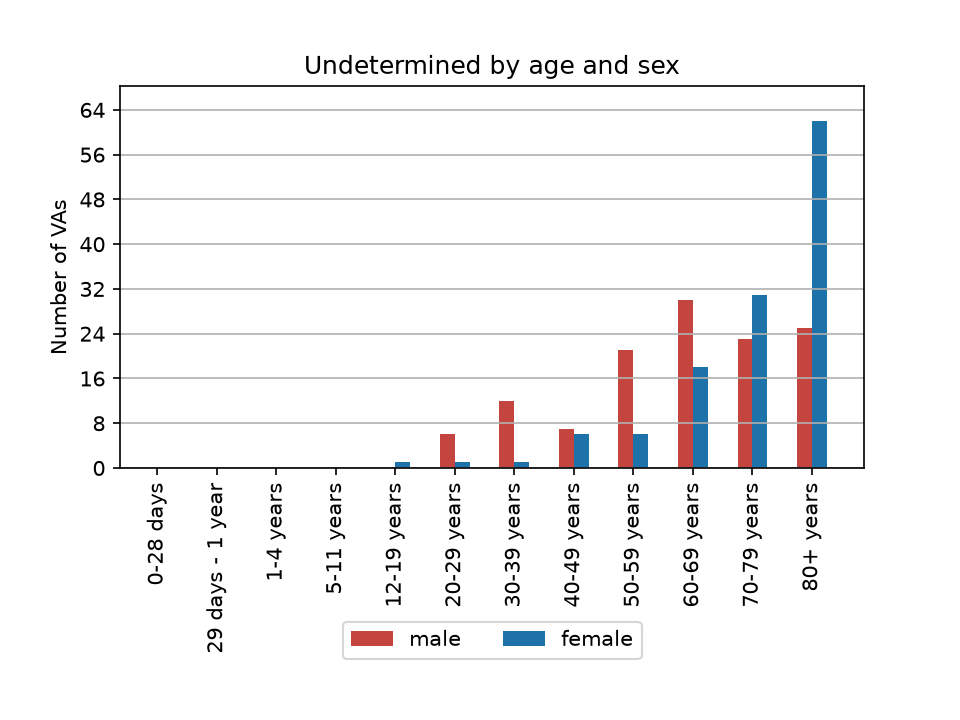 | 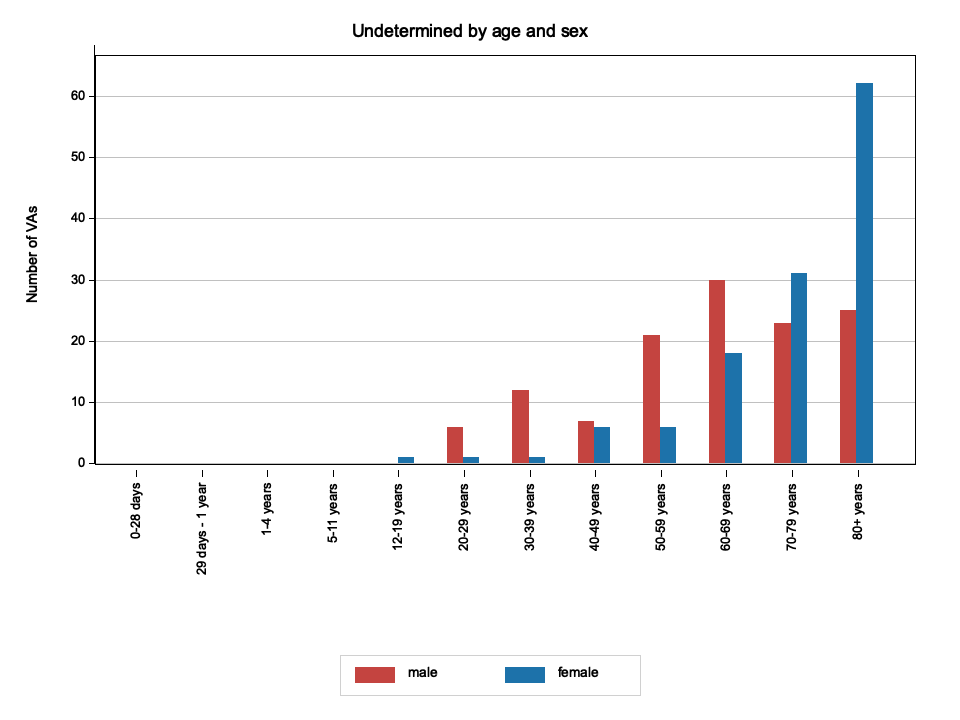 |

---

### Cohort-07

- **VAs Scored**: `1,169` | **`cause34` Parity**: `1,169 / 1,169` (`100.00%`) | **CSV Cell Diffs**: `0` | **Python**: `8532.9 ms` | **Rust Cold CLI**: `1016.5 ms` (**`8.39x`**) | **Rust Warm FFI**: `861.0 ms` (**`9.91x`**)
- **Aggregate CSV Tabulations (`0` Python vs. Rust diffs)**: [`csmf.csv`](./evidence/tabulations/Cohort-07/csmf.csv) · [`gbd-level1-csmf.csv`](./evidence/tabulations/Cohort-07/gbd-level1-csmf.csv) · [`adult-csmf.csv`](./evidence/tabulations/Cohort-07/adult-csmf.csv) · [`child-csmf.csv`](./evidence/tabulations/Cohort-07/child-csmf.csv) · [`neonate-csmf.csv`](./evidence/tabulations/Cohort-07/neonate-csmf.csv) · [`causes-of-death.csv`](./evidence/tabulations/Cohort-07/causes-of-death.csv) · [`VA-data-age-groupings.csv`](./evidence/tabulations/Cohort-07/VA-data-age-groupings.csv) · [`adult-endorsement-rates.csv`](./evidence/tabulations/Cohort-07/adult-endorsement-rates.csv) · [`child-endorsement-rates.csv`](./evidence/tabulations/Cohort-07/child-endorsement-rates.csv) · [`neonate-endorsement-rates.csv`](./evidence/tabulations/Cohort-07/neonate-endorsement-rates.csv)

#### Aggregate CSMF Summary (`gbd-level1-csmf.csv` & Top Causes in `csmf.csv`)

| GBD Level-1 Category | CSMF | | Top All-Age Cause (`cause34`) | ICD-10 | All | Male | Female |
| --- | ---: | --- | --- | :---: | ---: | ---: | ---: |
| Communicable, maternal, neonatal and nutritional diseases (`A`) | `0.224` | | Ischemic Heart Disease | `I24` | `0.172` | `0.182` | `0.155` |
| Non-communicable diseases (`B`) | `0.627` | | Diabetes | `E14` | `0.1` | `0.079` | `0.136` |
| Injuries (`C`) | `0.149` | | Chronic Respiratory | `J44` | `0.084` | `0.088` | `0.077` |
| | | | TB | `A16` | `0.068` | `0.083` | `0.042` |
| | | | Stroke | `I64` | `0.053` | `0.043` | `0.069` |
| | | | Road Traffic | `V89` | `0.052` | `0.06` | `0.038` |
| | | | Other Non-communicable Diseases | `UU1` | `0.041` | `0.038` | `0.046` |
| | | | Diarrhea/Dysentery | `A09` | `0.037` | `0.033` | `0.043` |

#### Side-by-Side CSMF & Cohort Charts: Upstream Python (`matplotlib`) vs. Pure-Rust (`plotters`)

| Chart | Upstream Python (`matplotlib`) | Pure-Rust `smartva-rust` (`plotters`) |
| --- | :---: | :---: |
| **Adult CSMF Bar Chart (`adult-csmf-figure.png`)** [Python PNG](./evidence/charts/Cohort-07/python/adult-csmf-figure.png) · [Rust PNG](./evidence/charts/Cohort-07/rust/adult-csmf-figure.png) |  |  |
| **Adult Female CSMF Bar Chart (`adult-female-csmf-figure.png`)** [Python PNG](./evidence/charts/Cohort-07/python/adult-female-csmf-figure.png) · [Rust PNG](./evidence/charts/Cohort-07/rust/adult-female-csmf-figure.png) |  | 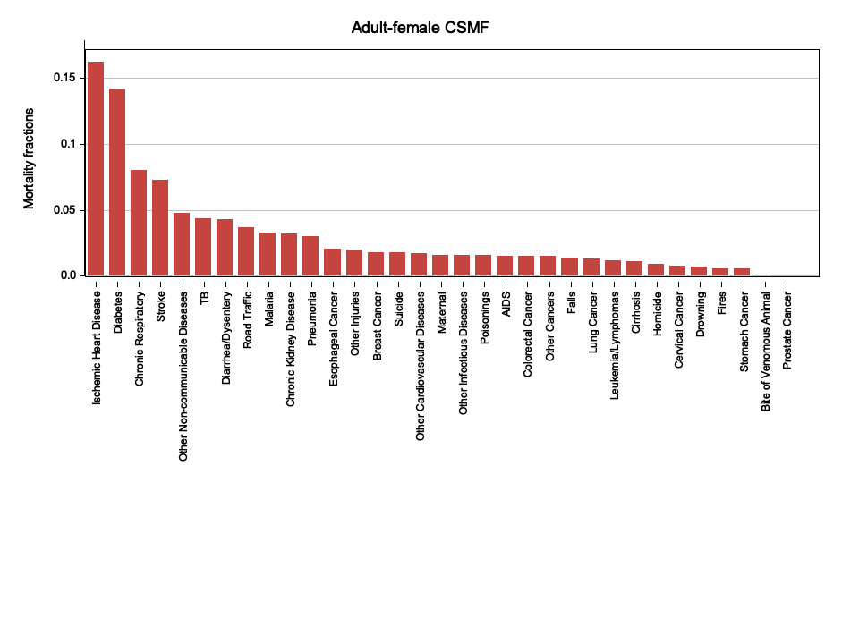 |
| **Adult Male CSMF Bar Chart (`adult-male-csmf-figure.png`)** [Python PNG](./evidence/charts/Cohort-07/python/adult-male-csmf-figure.png) · [Rust PNG](./evidence/charts/Cohort-07/rust/adult-male-csmf-figure.png) |  |  |
| **All-Age CSMF Bar Chart (`all-csmf-figure.png`)** [Python PNG](./evidence/charts/Cohort-07/python/all-csmf-figure.png) · [Rust PNG](./evidence/charts/Cohort-07/rust/all-csmf-figure.png) |  |  |
| **Age & Sex Distribution by Module (`all-figure.png`)** [Python PNG](./evidence/charts/Cohort-07/python/all-figure.png) · [Rust PNG](./evidence/charts/Cohort-07/rust/all-figure.png) | 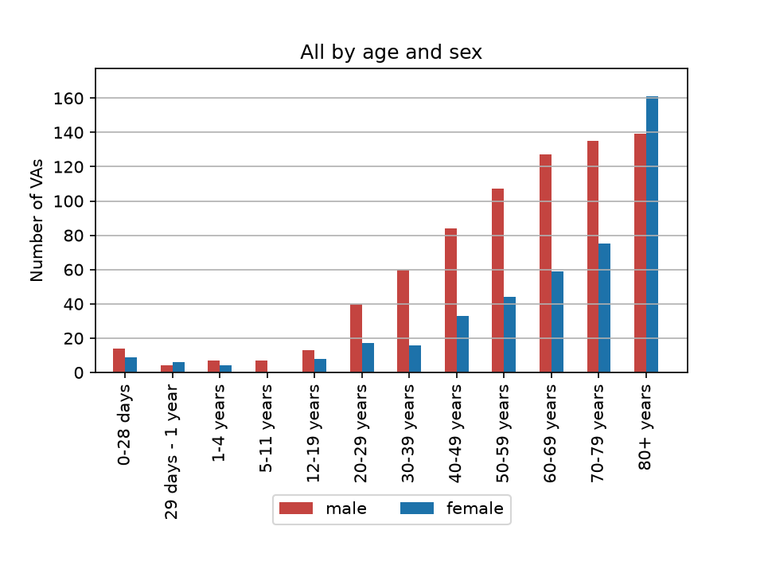 | 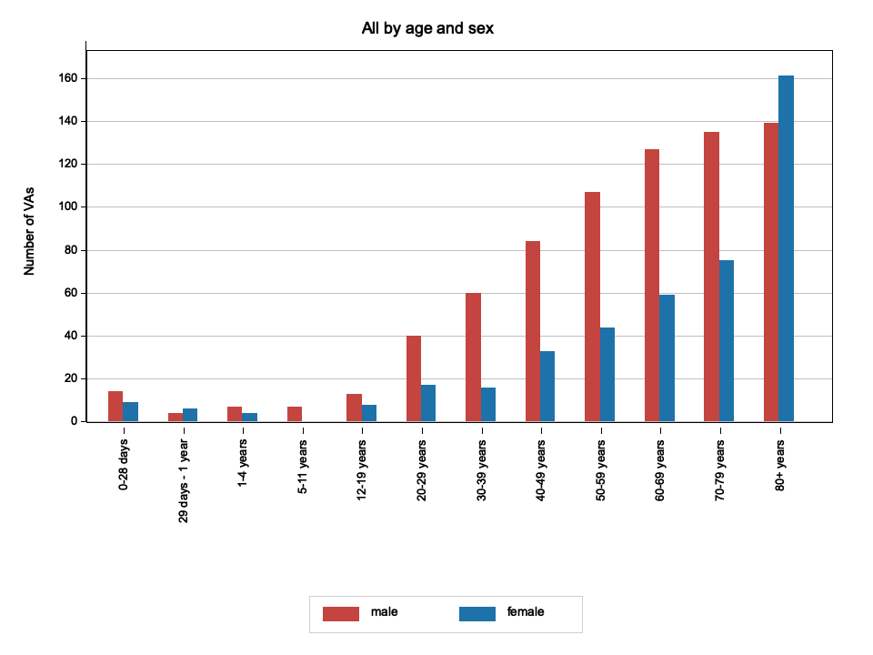 |
| **Child CSMF Bar Chart (`child-csmf-figure.png`)** [Python PNG](./evidence/charts/Cohort-07/python/child-csmf-figure.png) · [Rust PNG](./evidence/charts/Cohort-07/rust/child-csmf-figure.png) |  |  |
| **GBD Level-1 Cause Fractions Pie Chart (`gbd-level1-csmf.png`)** [Python PNG](./evidence/charts/Cohort-07/python/gbd-level1-csmf.png) · [Rust PNG](./evidence/charts/Cohort-07/rust/gbd-level1-csmf.png) |  |  |
| **Neonate CSMF Bar Chart (`neonate-csmf-figure.png`)** [Python PNG](./evidence/charts/Cohort-07/python/neonate-csmf-figure.png) · [Rust PNG](./evidence/charts/Cohort-07/rust/neonate-csmf-figure.png) |  |  |
| **Undetermined COD Distribution (`undetermined-figure.png`)** [Python PNG](./evidence/charts/Cohort-07/python/undetermined-figure.png) · [Rust PNG](./evidence/charts/Cohort-07/rust/undetermined-figure.png) |  |  |

---

### Cohort-08

- **VAs Scored**: `178` | **`cause34` Parity**: `178 / 178` (`100.00%`) | **CSV Cell Diffs**: `0` | **Python**: `4913.8 ms` | **Rust Cold CLI**: `382.0 ms` (**`12.86x`**) | **Rust Warm FFI**: `213.2 ms` (**`23.04x`**)
- **Aggregate CSV Tabulations (`0` Python vs. Rust diffs)**: [`csmf.csv`](./evidence/tabulations/Cohort-08/csmf.csv) · [`gbd-level1-csmf.csv`](./evidence/tabulations/Cohort-08/gbd-level1-csmf.csv) · [`adult-csmf.csv`](./evidence/tabulations/Cohort-08/adult-csmf.csv) · [`child-csmf.csv`](./evidence/tabulations/Cohort-08/child-csmf.csv) · [`neonate-csmf.csv`](./evidence/tabulations/Cohort-08/neonate-csmf.csv) · [`causes-of-death.csv`](./evidence/tabulations/Cohort-08/causes-of-death.csv) · [`VA-data-age-groupings.csv`](./evidence/tabulations/Cohort-08/VA-data-age-groupings.csv) · [`adult-endorsement-rates.csv`](./evidence/tabulations/Cohort-08/adult-endorsement-rates.csv) · [`child-endorsement-rates.csv`](./evidence/tabulations/Cohort-08/child-endorsement-rates.csv)

#### Aggregate CSMF Summary (`gbd-level1-csmf.csv` & Top Causes in `csmf.csv`)

| GBD Level-1 Category | CSMF | | Top All-Age Cause (`cause34`) | ICD-10 | All | Male | Female |
| --- | ---: | --- | --- | :---: | ---: | ---: | ---: |
| Communicable, maternal, neonatal and nutritional diseases (`A`) | `0.154` | | Ischemic Heart Disease | `I24` | `0.256` | `0.257` | `0.254` |
| Non-communicable diseases (`B`) | `0.715` | | Stroke | `I64` | `0.115` | `0.122` | `0.104` |
| Injuries (`C`) | `0.131` | | Diabetes | `E14` | `0.108` | `0.098` | `0.124` |
| | | | Diarrhea/Dysentery | `A09` | `0.081` | `0.057` | `0.118` |
| | | | Road Traffic | `V89` | `0.059` | `0.095` | `0.003` |
| | | | Chronic Respiratory | `J44` | `0.057` | `0.053` | `0.065` |
| | | | Chronic Kidney Disease | `N18` | `0.041` | `0.052` | `0.024` |
| | | | Suicide | `X84` | `0.035` | `0.038` | `0.031` |

#### Side-by-Side CSMF & Cohort Charts: Upstream Python (`matplotlib`) vs. Pure-Rust (`plotters`)

| Chart | Upstream Python (`matplotlib`) | Pure-Rust `smartva-rust` (`plotters`) |
| --- | :---: | :---: |
| **Adult CSMF Bar Chart (`adult-csmf-figure.png`)** [Python PNG](./evidence/charts/Cohort-08/python/adult-csmf-figure.png) · [Rust PNG](./evidence/charts/Cohort-08/rust/adult-csmf-figure.png) |  |  |
| **Adult Female CSMF Bar Chart (`adult-female-csmf-figure.png`)** [Python PNG](./evidence/charts/Cohort-08/python/adult-female-csmf-figure.png) · [Rust PNG](./evidence/charts/Cohort-08/rust/adult-female-csmf-figure.png) |  |  |
| **Adult Male CSMF Bar Chart (`adult-male-csmf-figure.png`)** [Python PNG](./evidence/charts/Cohort-08/python/adult-male-csmf-figure.png) · [Rust PNG](./evidence/charts/Cohort-08/rust/adult-male-csmf-figure.png) |  |  |
| **All-Age CSMF Bar Chart (`all-csmf-figure.png`)** [Python PNG](./evidence/charts/Cohort-08/python/all-csmf-figure.png) · [Rust PNG](./evidence/charts/Cohort-08/rust/all-csmf-figure.png) |  |  |
| **Age & Sex Distribution by Module (`all-figure.png`)** [Python PNG](./evidence/charts/Cohort-08/python/all-figure.png) · [Rust PNG](./evidence/charts/Cohort-08/rust/all-figure.png) |  |  |
| **Child CSMF Bar Chart (`child-csmf-figure.png`)** [Python PNG](./evidence/charts/Cohort-08/python/child-csmf-figure.png) · [Rust PNG](./evidence/charts/Cohort-08/rust/child-csmf-figure.png) |  |  |
| **GBD Level-1 Cause Fractions Pie Chart (`gbd-level1-csmf.png`)** [Python PNG](./evidence/charts/Cohort-08/python/gbd-level1-csmf.png) · [Rust PNG](./evidence/charts/Cohort-08/rust/gbd-level1-csmf.png) |  |  |
| **Undetermined COD Distribution (`undetermined-figure.png`)** [Python PNG](./evidence/charts/Cohort-08/python/undetermined-figure.png) · [Rust PNG](./evidence/charts/Cohort-08/rust/undetermined-figure.png) |  |  |

---

### Cohort-09

- **VAs Scored**: `59` | **`cause34` Parity**: `59 / 59` (`100.00%`) | **CSV Cell Diffs**: `0` | **Python**: `3959.8 ms` | **Rust Cold CLI**: `265.6 ms` (**`14.91x`**) | **Rust Warm FFI**: `107.5 ms` (**`36.83x`**)
- **Aggregate CSV Tabulations (`0` Python vs. Rust diffs)**: [`csmf.csv`](./evidence/tabulations/Cohort-09/csmf.csv) · [`gbd-level1-csmf.csv`](./evidence/tabulations/Cohort-09/gbd-level1-csmf.csv) · [`adult-csmf.csv`](./evidence/tabulations/Cohort-09/adult-csmf.csv) · [`child-csmf.csv`](./evidence/tabulations/Cohort-09/child-csmf.csv) · [`neonate-csmf.csv`](./evidence/tabulations/Cohort-09/neonate-csmf.csv) · [`causes-of-death.csv`](./evidence/tabulations/Cohort-09/causes-of-death.csv) · [`VA-data-age-groupings.csv`](./evidence/tabulations/Cohort-09/VA-data-age-groupings.csv) · [`adult-endorsement-rates.csv`](./evidence/tabulations/Cohort-09/adult-endorsement-rates.csv)

#### Aggregate CSMF Summary (`gbd-level1-csmf.csv` & Top Causes in `csmf.csv`)

| GBD Level-1 Category | CSMF | | Top All-Age Cause (`cause34`) | ICD-10 | All | Male | Female |
| --- | ---: | --- | --- | :---: | ---: | ---: | ---: |
| Communicable, maternal, neonatal and nutritional diseases (`A`) | `0.217` | | Ischemic Heart Disease | `I24` | `0.185` | `0.104` | `0.289` |
| Non-communicable diseases (`B`) | `0.689` | | Diarrhea/Dysentery | `A09` | `0.164` | `0.129` | `0.208` |
| Injuries (`C`) | `0.094` | | Stroke | `I64` | `0.13` | `0.16` | `0.092` |
| | | | Diabetes | `E14` | `0.108` | `0.126` | `0.085` |
| | | | Chronic Respiratory | `J44` | `0.1` | `0.133` | `0.057` |
| | | | Cirrhosis | `K74` | `0.055` | `0.094` | `0.006` |
| | | | Chronic Kidney Disease | `N18` | `0.04` | `0.065` | `0.009` |
| | | | Falls | `W19` | `0.037` | `0.032` | `0.042` |

#### Side-by-Side CSMF & Cohort Charts: Upstream Python (`matplotlib`) vs. Pure-Rust (`plotters`)

| Chart | Upstream Python (`matplotlib`) | Pure-Rust `smartva-rust` (`plotters`) |
| --- | :---: | :---: |
| **Adult CSMF Bar Chart (`adult-csmf-figure.png`)** [Python PNG](./evidence/charts/Cohort-09/python/adult-csmf-figure.png) · [Rust PNG](./evidence/charts/Cohort-09/rust/adult-csmf-figure.png) |  |  |
| **Adult Female CSMF Bar Chart (`adult-female-csmf-figure.png`)** [Python PNG](./evidence/charts/Cohort-09/python/adult-female-csmf-figure.png) · [Rust PNG](./evidence/charts/Cohort-09/rust/adult-female-csmf-figure.png) |  |  |
| **Adult Male CSMF Bar Chart (`adult-male-csmf-figure.png`)** [Python PNG](./evidence/charts/Cohort-09/python/adult-male-csmf-figure.png) · [Rust PNG](./evidence/charts/Cohort-09/rust/adult-male-csmf-figure.png) |  |  |
| **All-Age CSMF Bar Chart (`all-csmf-figure.png`)** [Python PNG](./evidence/charts/Cohort-09/python/all-csmf-figure.png) · [Rust PNG](./evidence/charts/Cohort-09/rust/all-csmf-figure.png) |  |  |
| **Age & Sex Distribution by Module (`all-figure.png`)** [Python PNG](./evidence/charts/Cohort-09/python/all-figure.png) · [Rust PNG](./evidence/charts/Cohort-09/rust/all-figure.png) |  |  |
| **GBD Level-1 Cause Fractions Pie Chart (`gbd-level1-csmf.png`)** [Python PNG](./evidence/charts/Cohort-09/python/gbd-level1-csmf.png) · [Rust PNG](./evidence/charts/Cohort-09/rust/gbd-level1-csmf.png) |  |  |
| **Undetermined COD Distribution (`undetermined-figure.png`)** [Python PNG](./evidence/charts/Cohort-09/python/undetermined-figure.png) · [Rust PNG](./evidence/charts/Cohort-09/rust/undetermined-figure.png) |  |  |

---

### Cohort-10

- **VAs Scored**: `23` | **`cause34` Parity**: `23 / 23` (`100.00%`) | **CSV Cell Diffs**: `0` | **Python**: `3439.8 ms` | **Rust Cold CLI**: `244.1 ms` (**`14.09x`**) | **Rust Warm FFI**: `82.5 ms` (**`41.71x`**)
- **Aggregate CSV Tabulations (`0` Python vs. Rust diffs)**: [`csmf.csv`](./evidence/tabulations/Cohort-10/csmf.csv) · [`gbd-level1-csmf.csv`](./evidence/tabulations/Cohort-10/gbd-level1-csmf.csv) · [`adult-csmf.csv`](./evidence/tabulations/Cohort-10/adult-csmf.csv) · [`child-csmf.csv`](./evidence/tabulations/Cohort-10/child-csmf.csv) · [`neonate-csmf.csv`](./evidence/tabulations/Cohort-10/neonate-csmf.csv) · [`causes-of-death.csv`](./evidence/tabulations/Cohort-10/causes-of-death.csv) · [`VA-data-age-groupings.csv`](./evidence/tabulations/Cohort-10/VA-data-age-groupings.csv) · [`adult-endorsement-rates.csv`](./evidence/tabulations/Cohort-10/adult-endorsement-rates.csv)

#### Aggregate CSMF Summary (`gbd-level1-csmf.csv` & Top Causes in `csmf.csv`)

| GBD Level-1 Category | CSMF | | Top All-Age Cause (`cause34`) | ICD-10 | All | Male | Female |
| --- | ---: | --- | --- | :---: | ---: | ---: | ---: |
| Communicable, maternal, neonatal and nutritional diseases (`A`) | `0.151` | | Diabetes | `E14` | `0.188` | `0.216` | `0.136` |
| Non-communicable diseases (`B`) | `0.652` | | Ischemic Heart Disease | `I24` | `0.166` | `0.177` | `0.148` |
| Injuries (`C`) | `0.197` | | Stroke | `I64` | `0.112` | `0.029` | `0.268` |
| | | | Chronic Respiratory | `J44` | `0.076` | `0.038` | `0.149` |
| | | | TB | `A16` | `0.057` | `0.084` | `0.008` |
| | | | Road Traffic | `V89` | `0.052` | `0.078` | `0.004` |
| | | | Falls | `W19` | `0.05` | `0.075` | `0.004` |
| | | | Bite of Venomous Animal | `X27` | `0.044` | `0.001` | `0.125` |

#### Side-by-Side CSMF & Cohort Charts: Upstream Python (`matplotlib`) vs. Pure-Rust (`plotters`)

| Chart | Upstream Python (`matplotlib`) | Pure-Rust `smartva-rust` (`plotters`) |
| --- | :---: | :---: |
| **Adult CSMF Bar Chart (`adult-csmf-figure.png`)** [Python PNG](./evidence/charts/Cohort-10/python/adult-csmf-figure.png) · [Rust PNG](./evidence/charts/Cohort-10/rust/adult-csmf-figure.png) |  |  |
| **Adult Female CSMF Bar Chart (`adult-female-csmf-figure.png`)** [Python PNG](./evidence/charts/Cohort-10/python/adult-female-csmf-figure.png) · [Rust PNG](./evidence/charts/Cohort-10/rust/adult-female-csmf-figure.png) |  |  |
| **Adult Male CSMF Bar Chart (`adult-male-csmf-figure.png`)** [Python PNG](./evidence/charts/Cohort-10/python/adult-male-csmf-figure.png) · [Rust PNG](./evidence/charts/Cohort-10/rust/adult-male-csmf-figure.png) |  |  |
| **All-Age CSMF Bar Chart (`all-csmf-figure.png`)** [Python PNG](./evidence/charts/Cohort-10/python/all-csmf-figure.png) · [Rust PNG](./evidence/charts/Cohort-10/rust/all-csmf-figure.png) |  |  |
| **Age & Sex Distribution by Module (`all-figure.png`)** [Python PNG](./evidence/charts/Cohort-10/python/all-figure.png) · [Rust PNG](./evidence/charts/Cohort-10/rust/all-figure.png) |  |  |
| **GBD Level-1 Cause Fractions Pie Chart (`gbd-level1-csmf.png`)** [Python PNG](./evidence/charts/Cohort-10/python/gbd-level1-csmf.png) · [Rust PNG](./evidence/charts/Cohort-10/rust/gbd-level1-csmf.png) |  |  |
| **Undetermined COD Distribution (`undetermined-figure.png`)** [Python PNG](./evidence/charts/Cohort-10/python/undetermined-figure.png) · [Rust PNG](./evidence/charts/Cohort-10/rust/undetermined-figure.png) |  |  |

---

### Cohort-11

- **VAs Scored**: `116` | **`cause34` Parity**: `116 / 116` (`100.00%`) | **CSV Cell Diffs**: `0` | **Python**: `4414.2 ms` | **Rust Cold CLI**: `300.8 ms` (**`14.67x`**) | **Rust Warm FFI**: `148.0 ms` (**`29.83x`**)
- **Aggregate CSV Tabulations (`0` Python vs. Rust diffs)**: [`csmf.csv`](./evidence/tabulations/Cohort-11/csmf.csv) · [`gbd-level1-csmf.csv`](./evidence/tabulations/Cohort-11/gbd-level1-csmf.csv) · [`adult-csmf.csv`](./evidence/tabulations/Cohort-11/adult-csmf.csv) · [`child-csmf.csv`](./evidence/tabulations/Cohort-11/child-csmf.csv) · [`neonate-csmf.csv`](./evidence/tabulations/Cohort-11/neonate-csmf.csv) · [`causes-of-death.csv`](./evidence/tabulations/Cohort-11/causes-of-death.csv) · [`VA-data-age-groupings.csv`](./evidence/tabulations/Cohort-11/VA-data-age-groupings.csv) · [`adult-endorsement-rates.csv`](./evidence/tabulations/Cohort-11/adult-endorsement-rates.csv)

#### Aggregate CSMF Summary (`gbd-level1-csmf.csv` & Top Causes in `csmf.csv`)

| GBD Level-1 Category | CSMF | | Top All-Age Cause (`cause34`) | ICD-10 | All | Male | Female |
| --- | ---: | --- | --- | :---: | ---: | ---: | ---: |
| Communicable, maternal, neonatal and nutritional diseases (`A`) | `0.17` | | Ischemic Heart Disease | `I24` | `0.207` | `0.221` | `0.189` |
| Non-communicable diseases (`B`) | `0.737` | | Diabetes | `E14` | `0.105` | `0.024` | `0.212` |
| Injuries (`C`) | `0.093` | | Chronic Respiratory | `J44` | `0.1` | `0.11` | `0.087` |
| | | | Stroke | `I64` | `0.079` | `0.092` | `0.062` |
| | | | TB | `A16` | `0.071` | `0.088` | `0.049` |
| | | | Suicide | `X84` | `0.039` | `0.065` | `0.003` |
| | | | Lung Cancer | `C34` | `0.038` | `0.019` | `0.064` |
| | | | Prostate Cancer | `C61` | `0.037` | `0.064` | `0.0` |

#### Side-by-Side CSMF & Cohort Charts: Upstream Python (`matplotlib`) vs. Pure-Rust (`plotters`)

| Chart | Upstream Python (`matplotlib`) | Pure-Rust `smartva-rust` (`plotters`) |
| --- | :---: | :---: |
| **Adult CSMF Bar Chart (`adult-csmf-figure.png`)** [Python PNG](./evidence/charts/Cohort-11/python/adult-csmf-figure.png) · [Rust PNG](./evidence/charts/Cohort-11/rust/adult-csmf-figure.png) |  |  |
| **Adult Female CSMF Bar Chart (`adult-female-csmf-figure.png`)** [Python PNG](./evidence/charts/Cohort-11/python/adult-female-csmf-figure.png) · [Rust PNG](./evidence/charts/Cohort-11/rust/adult-female-csmf-figure.png) |  |  |
| **Adult Male CSMF Bar Chart (`adult-male-csmf-figure.png`)** [Python PNG](./evidence/charts/Cohort-11/python/adult-male-csmf-figure.png) · [Rust PNG](./evidence/charts/Cohort-11/rust/adult-male-csmf-figure.png) |  |  |
| **All-Age CSMF Bar Chart (`all-csmf-figure.png`)** [Python PNG](./evidence/charts/Cohort-11/python/all-csmf-figure.png) · [Rust PNG](./evidence/charts/Cohort-11/rust/all-csmf-figure.png) |  |  |
| **Age & Sex Distribution by Module (`all-figure.png`)** [Python PNG](./evidence/charts/Cohort-11/python/all-figure.png) · [Rust PNG](./evidence/charts/Cohort-11/rust/all-figure.png) |  |  |
| **GBD Level-1 Cause Fractions Pie Chart (`gbd-level1-csmf.png`)** [Python PNG](./evidence/charts/Cohort-11/python/gbd-level1-csmf.png) · [Rust PNG](./evidence/charts/Cohort-11/rust/gbd-level1-csmf.png) |  |  |
| **Undetermined COD Distribution (`undetermined-figure.png`)** [Python PNG](./evidence/charts/Cohort-11/python/undetermined-figure.png) · [Rust PNG](./evidence/charts/Cohort-11/rust/undetermined-figure.png) |  |  |

---

### Cohort-12

- **VAs Scored**: `256` | **`cause34` Parity**: `256 / 256` (`100.00%`) | **CSV Cell Diffs**: `0` | **Python**: `6388.6 ms` | **Rust Cold CLI**: `468.4 ms` (**`13.64x`**) | **Rust Warm FFI**: `279.2 ms` (**`22.89x`**)
- **Aggregate CSV Tabulations (`0` Python vs. Rust diffs)**: [`csmf.csv`](./evidence/tabulations/Cohort-12/csmf.csv) · [`gbd-level1-csmf.csv`](./evidence/tabulations/Cohort-12/gbd-level1-csmf.csv) · [`adult-csmf.csv`](./evidence/tabulations/Cohort-12/adult-csmf.csv) · [`child-csmf.csv`](./evidence/tabulations/Cohort-12/child-csmf.csv) · [`neonate-csmf.csv`](./evidence/tabulations/Cohort-12/neonate-csmf.csv) · [`causes-of-death.csv`](./evidence/tabulations/Cohort-12/causes-of-death.csv) · [`VA-data-age-groupings.csv`](./evidence/tabulations/Cohort-12/VA-data-age-groupings.csv) · [`adult-endorsement-rates.csv`](./evidence/tabulations/Cohort-12/adult-endorsement-rates.csv) · [`child-endorsement-rates.csv`](./evidence/tabulations/Cohort-12/child-endorsement-rates.csv) · [`neonate-endorsement-rates.csv`](./evidence/tabulations/Cohort-12/neonate-endorsement-rates.csv)

#### Aggregate CSMF Summary (`gbd-level1-csmf.csv` & Top Causes in `csmf.csv`)

| GBD Level-1 Category | CSMF | | Top All-Age Cause (`cause34`) | ICD-10 | All | Male | Female |
| --- | ---: | --- | --- | :---: | ---: | ---: | ---: |
| Communicable, maternal, neonatal and nutritional diseases (`A`) | `0.197` | | Ischemic Heart Disease | `I24` | `0.276` | `0.285` | `0.261` |
| Non-communicable diseases (`B`) | `0.698` | | Stroke | `I64` | `0.095` | `0.078` | `0.122` |
| Injuries (`C`) | `0.105` | | Diabetes | `E14` | `0.069` | `0.056` | `0.092` |
| | | | Cirrhosis | `K74` | `0.06` | `0.093` | `0.006` |
| | | | Chronic Respiratory | `J44` | `0.047` | `0.029` | `0.075` |
| | | | Diarrhea/Dysentery | `A09` | `0.042` | `0.029` | `0.057` |
| | | | Pneumonia | `J22` | `0.036` | `0.041` | `0.038` |
| | | | Chronic Kidney Disease | `N18` | `0.031` | `0.037` | `0.021` |

#### Side-by-Side CSMF & Cohort Charts: Upstream Python (`matplotlib`) vs. Pure-Rust (`plotters`)

| Chart | Upstream Python (`matplotlib`) | Pure-Rust `smartva-rust` (`plotters`) |
| --- | :---: | :---: |
| **Adult CSMF Bar Chart (`adult-csmf-figure.png`)** [Python PNG](./evidence/charts/Cohort-12/python/adult-csmf-figure.png) · [Rust PNG](./evidence/charts/Cohort-12/rust/adult-csmf-figure.png) |  |  |
| **Adult Female CSMF Bar Chart (`adult-female-csmf-figure.png`)** [Python PNG](./evidence/charts/Cohort-12/python/adult-female-csmf-figure.png) · [Rust PNG](./evidence/charts/Cohort-12/rust/adult-female-csmf-figure.png) |  |  |
| **Adult Male CSMF Bar Chart (`adult-male-csmf-figure.png`)** [Python PNG](./evidence/charts/Cohort-12/python/adult-male-csmf-figure.png) · [Rust PNG](./evidence/charts/Cohort-12/rust/adult-male-csmf-figure.png) |  |  |
| **All-Age CSMF Bar Chart (`all-csmf-figure.png`)** [Python PNG](./evidence/charts/Cohort-12/python/all-csmf-figure.png) · [Rust PNG](./evidence/charts/Cohort-12/rust/all-csmf-figure.png) |  |  |
| **Age & Sex Distribution by Module (`all-figure.png`)** [Python PNG](./evidence/charts/Cohort-12/python/all-figure.png) · [Rust PNG](./evidence/charts/Cohort-12/rust/all-figure.png) |  |  |
| **Child CSMF Bar Chart (`child-csmf-figure.png`)** [Python PNG](./evidence/charts/Cohort-12/python/child-csmf-figure.png) · [Rust PNG](./evidence/charts/Cohort-12/rust/child-csmf-figure.png) |  |  |
| **GBD Level-1 Cause Fractions Pie Chart (`gbd-level1-csmf.png`)** [Python PNG](./evidence/charts/Cohort-12/python/gbd-level1-csmf.png) · [Rust PNG](./evidence/charts/Cohort-12/rust/gbd-level1-csmf.png) |  |  |
| **Neonate CSMF Bar Chart (`neonate-csmf-figure.png`)** [Python PNG](./evidence/charts/Cohort-12/python/neonate-csmf-figure.png) · [Rust PNG](./evidence/charts/Cohort-12/rust/neonate-csmf-figure.png) |  |  |
| **Undetermined COD Distribution (`undetermined-figure.png`)** [Python PNG](./evidence/charts/Cohort-12/python/undetermined-figure.png) · [Rust PNG](./evidence/charts/Cohort-12/rust/undetermined-figure.png) |  |  |

---

### Cohort-13

- **VAs Scored**: `255` | **`cause34` Parity**: `255 / 255` (`100.00%`) | **CSV Cell Diffs**: `0` | **Python**: `5452.4 ms` | **Rust Cold CLI**: `461.9 ms` (**`11.80x`**) | **Rust Warm FFI**: `283.1 ms` (**`19.26x`**)
- **Aggregate CSV Tabulations (`0` Python vs. Rust diffs)**: [`csmf.csv`](./evidence/tabulations/Cohort-13/csmf.csv) · [`gbd-level1-csmf.csv`](./evidence/tabulations/Cohort-13/gbd-level1-csmf.csv) · [`adult-csmf.csv`](./evidence/tabulations/Cohort-13/adult-csmf.csv) · [`child-csmf.csv`](./evidence/tabulations/Cohort-13/child-csmf.csv) · [`neonate-csmf.csv`](./evidence/tabulations/Cohort-13/neonate-csmf.csv) · [`causes-of-death.csv`](./evidence/tabulations/Cohort-13/causes-of-death.csv) · [`VA-data-age-groupings.csv`](./evidence/tabulations/Cohort-13/VA-data-age-groupings.csv) · [`adult-endorsement-rates.csv`](./evidence/tabulations/Cohort-13/adult-endorsement-rates.csv)

#### Aggregate CSMF Summary (`gbd-level1-csmf.csv` & Top Causes in `csmf.csv`)

| GBD Level-1 Category | CSMF | | Top All-Age Cause (`cause34`) | ICD-10 | All | Male | Female |
| --- | ---: | --- | --- | :---: | ---: | ---: | ---: |
| Communicable, maternal, neonatal and nutritional diseases (`A`) | `0.074` | | Ischemic Heart Disease | `I24` | `0.24` | `0.261` | `0.208` |
| Non-communicable diseases (`B`) | `0.828` | | Stroke | `I64` | `0.181` | `0.205` | `0.146` |
| Injuries (`C`) | `0.098` | | Diabetes | `E14` | `0.142` | `0.083` | `0.227` |
| | | | Chronic Respiratory | `J44` | `0.07` | `0.035` | `0.12` |
| | | | Cirrhosis | `K74` | `0.07` | `0.109` | `0.013` |
| | | | Chronic Kidney Disease | `N18` | `0.032` | `0.03` | `0.035` |
| | | | Falls | `W19` | `0.03` | `0.022` | `0.041` |
| | | | Road Traffic | `V89` | `0.026` | `0.029` | `0.022` |

#### Side-by-Side CSMF & Cohort Charts: Upstream Python (`matplotlib`) vs. Pure-Rust (`plotters`)

| Chart | Upstream Python (`matplotlib`) | Pure-Rust `smartva-rust` (`plotters`) |
| --- | :---: | :---: |
| **Adult CSMF Bar Chart (`adult-csmf-figure.png`)** [Python PNG](./evidence/charts/Cohort-13/python/adult-csmf-figure.png) · [Rust PNG](./evidence/charts/Cohort-13/rust/adult-csmf-figure.png) |  |  |
| **Adult Female CSMF Bar Chart (`adult-female-csmf-figure.png`)** [Python PNG](./evidence/charts/Cohort-13/python/adult-female-csmf-figure.png) · [Rust PNG](./evidence/charts/Cohort-13/rust/adult-female-csmf-figure.png) |  |  |
| **Adult Male CSMF Bar Chart (`adult-male-csmf-figure.png`)** [Python PNG](./evidence/charts/Cohort-13/python/adult-male-csmf-figure.png) · [Rust PNG](./evidence/charts/Cohort-13/rust/adult-male-csmf-figure.png) |  |  |
| **All-Age CSMF Bar Chart (`all-csmf-figure.png`)** [Python PNG](./evidence/charts/Cohort-13/python/all-csmf-figure.png) · [Rust PNG](./evidence/charts/Cohort-13/rust/all-csmf-figure.png) |  |  |
| **Age & Sex Distribution by Module (`all-figure.png`)** [Python PNG](./evidence/charts/Cohort-13/python/all-figure.png) · [Rust PNG](./evidence/charts/Cohort-13/rust/all-figure.png) |  |  |
| **GBD Level-1 Cause Fractions Pie Chart (`gbd-level1-csmf.png`)** [Python PNG](./evidence/charts/Cohort-13/python/gbd-level1-csmf.png) · [Rust PNG](./evidence/charts/Cohort-13/rust/gbd-level1-csmf.png) |  |  |
| **Undetermined COD Distribution (`undetermined-figure.png`)** [Python PNG](./evidence/charts/Cohort-13/python/undetermined-figure.png) · [Rust PNG](./evidence/charts/Cohort-13/rust/undetermined-figure.png) |  |  |

---

### Cohort-14

- **VAs Scored**: `227` | **`cause34` Parity**: `227 / 227` (`100.00%`) | **CSV Cell Diffs**: `0` | **Python**: `6263.1 ms` | **Rust Cold CLI**: `424.5 ms` (**`14.75x`**) | **Rust Warm FFI**: `244.6 ms` (**`25.61x`**)
- **Aggregate CSV Tabulations (`0` Python vs. Rust diffs)**: [`csmf.csv`](./evidence/tabulations/Cohort-14/csmf.csv) · [`gbd-level1-csmf.csv`](./evidence/tabulations/Cohort-14/gbd-level1-csmf.csv) · [`adult-csmf.csv`](./evidence/tabulations/Cohort-14/adult-csmf.csv) · [`child-csmf.csv`](./evidence/tabulations/Cohort-14/child-csmf.csv) · [`neonate-csmf.csv`](./evidence/tabulations/Cohort-14/neonate-csmf.csv) · [`causes-of-death.csv`](./evidence/tabulations/Cohort-14/causes-of-death.csv) · [`VA-data-age-groupings.csv`](./evidence/tabulations/Cohort-14/VA-data-age-groupings.csv) · [`adult-endorsement-rates.csv`](./evidence/tabulations/Cohort-14/adult-endorsement-rates.csv) · [`child-endorsement-rates.csv`](./evidence/tabulations/Cohort-14/child-endorsement-rates.csv) · [`neonate-endorsement-rates.csv`](./evidence/tabulations/Cohort-14/neonate-endorsement-rates.csv)

#### Aggregate CSMF Summary (`gbd-level1-csmf.csv` & Top Causes in `csmf.csv`)

| GBD Level-1 Category | CSMF | | Top All-Age Cause (`cause34`) | ICD-10 | All | Male | Female |
| --- | ---: | --- | --- | :---: | ---: | ---: | ---: |
| Communicable, maternal, neonatal and nutritional diseases (`A`) | `0.228` | | Ischemic Heart Disease | `I24` | `0.206` | `0.226` | `0.171` |
| Non-communicable diseases (`B`) | `0.626` | | Diabetes | `E14` | `0.144` | `0.117` | `0.193` |
| Injuries (`C`) | `0.146` | | Pneumonia | `J22` | `0.053` | `0.061` | `0.045` |
| | | | Cirrhosis | `K74` | `0.046` | `0.068` | `0.006` |
| | | | Chronic Respiratory | `J44` | `0.044` | `0.049` | `0.034` |
| | | | TB | `A16` | `0.044` | `0.043` | `0.044` |
| | | | Diarrhea/Dysentery | `A09` | `0.043` | `0.04` | `0.056` |
| | | | Road Traffic | `V89` | `0.036` | `0.036` | `0.041` |

#### Side-by-Side CSMF & Cohort Charts: Upstream Python (`matplotlib`) vs. Pure-Rust (`plotters`)

| Chart | Upstream Python (`matplotlib`) | Pure-Rust `smartva-rust` (`plotters`) |
| --- | :---: | :---: |
| **Adult CSMF Bar Chart (`adult-csmf-figure.png`)** [Python PNG](./evidence/charts/Cohort-14/python/adult-csmf-figure.png) · [Rust PNG](./evidence/charts/Cohort-14/rust/adult-csmf-figure.png) |  |  |
| **Adult Female CSMF Bar Chart (`adult-female-csmf-figure.png`)** [Python PNG](./evidence/charts/Cohort-14/python/adult-female-csmf-figure.png) · [Rust PNG](./evidence/charts/Cohort-14/rust/adult-female-csmf-figure.png) |  |  |
| **Adult Male CSMF Bar Chart (`adult-male-csmf-figure.png`)** [Python PNG](./evidence/charts/Cohort-14/python/adult-male-csmf-figure.png) · [Rust PNG](./evidence/charts/Cohort-14/rust/adult-male-csmf-figure.png) |  |  |
| **All-Age CSMF Bar Chart (`all-csmf-figure.png`)** [Python PNG](./evidence/charts/Cohort-14/python/all-csmf-figure.png) · [Rust PNG](./evidence/charts/Cohort-14/rust/all-csmf-figure.png) |  |  |
| **Age & Sex Distribution by Module (`all-figure.png`)** [Python PNG](./evidence/charts/Cohort-14/python/all-figure.png) · [Rust PNG](./evidence/charts/Cohort-14/rust/all-figure.png) |  |  |
| **Child CSMF Bar Chart (`child-csmf-figure.png`)** [Python PNG](./evidence/charts/Cohort-14/python/child-csmf-figure.png) · [Rust PNG](./evidence/charts/Cohort-14/rust/child-csmf-figure.png) |  |  |
| **GBD Level-1 Cause Fractions Pie Chart (`gbd-level1-csmf.png`)** [Python PNG](./evidence/charts/Cohort-14/python/gbd-level1-csmf.png) · [Rust PNG](./evidence/charts/Cohort-14/rust/gbd-level1-csmf.png) |  |  |
| **Neonate CSMF Bar Chart (`neonate-csmf-figure.png`)** [Python PNG](./evidence/charts/Cohort-14/python/neonate-csmf-figure.png) · [Rust PNG](./evidence/charts/Cohort-14/rust/neonate-csmf-figure.png) |  |  |
| **Undetermined COD Distribution (`undetermined-figure.png`)** [Python PNG](./evidence/charts/Cohort-14/python/undetermined-figure.png) · [Rust PNG](./evidence/charts/Cohort-14/rust/undetermined-figure.png) |  |  |

---

### Cohort-15

- **VAs Scored**: `227` | **`cause34` Parity**: `227 / 227` (`100.00%`) | **CSV Cell Diffs**: `0` | **Python**: `5718.8 ms` | **Rust Cold CLI**: `428.8 ms` (**`13.34x`**) | **Rust Warm FFI**: `263.0 ms` (**`21.74x`**)
- **Aggregate CSV Tabulations (`0` Python vs. Rust diffs)**: [`csmf.csv`](./evidence/tabulations/Cohort-15/csmf.csv) · [`gbd-level1-csmf.csv`](./evidence/tabulations/Cohort-15/gbd-level1-csmf.csv) · [`adult-csmf.csv`](./evidence/tabulations/Cohort-15/adult-csmf.csv) · [`child-csmf.csv`](./evidence/tabulations/Cohort-15/child-csmf.csv) · [`neonate-csmf.csv`](./evidence/tabulations/Cohort-15/neonate-csmf.csv) · [`causes-of-death.csv`](./evidence/tabulations/Cohort-15/causes-of-death.csv) · [`VA-data-age-groupings.csv`](./evidence/tabulations/Cohort-15/VA-data-age-groupings.csv) · [`adult-endorsement-rates.csv`](./evidence/tabulations/Cohort-15/adult-endorsement-rates.csv) · [`child-endorsement-rates.csv`](./evidence/tabulations/Cohort-15/child-endorsement-rates.csv)

#### Aggregate CSMF Summary (`gbd-level1-csmf.csv` & Top Causes in `csmf.csv`)

| GBD Level-1 Category | CSMF | | Top All-Age Cause (`cause34`) | ICD-10 | All | Male | Female |
| --- | ---: | --- | --- | :---: | ---: | ---: | ---: |
| Communicable, maternal, neonatal and nutritional diseases (`A`) | `0.174` | | Ischemic Heart Disease | `I24` | `0.132` | `0.122` | `0.146` |
| Non-communicable diseases (`B`) | `0.658` | | Stroke | `I64` | `0.11` | `0.112` | `0.108` |
| Injuries (`C`) | `0.169` | | Diabetes | `E14` | `0.1` | `0.103` | `0.095` |
| | | | Suicide | `X84` | `0.075` | `0.09` | `0.055` |
| | | | Chronic Kidney Disease | `N18` | `0.056` | `0.065` | `0.045` |
| | | | Other Non-communicable Diseases | `UU1` | `0.051` | `0.053` | `0.048` |
| | | | Chronic Respiratory | `J44` | `0.05` | `0.056` | `0.043` |
| | | | Cirrhosis | `K74` | `0.048` | `0.047` | `0.049` |

#### Side-by-Side CSMF & Cohort Charts: Upstream Python (`matplotlib`) vs. Pure-Rust (`plotters`)

| Chart | Upstream Python (`matplotlib`) | Pure-Rust `smartva-rust` (`plotters`) |
| --- | :---: | :---: |
| **Adult CSMF Bar Chart (`adult-csmf-figure.png`)** [Python PNG](./evidence/charts/Cohort-15/python/adult-csmf-figure.png) · [Rust PNG](./evidence/charts/Cohort-15/rust/adult-csmf-figure.png) |  |  |
| **Adult Female CSMF Bar Chart (`adult-female-csmf-figure.png`)** [Python PNG](./evidence/charts/Cohort-15/python/adult-female-csmf-figure.png) · [Rust PNG](./evidence/charts/Cohort-15/rust/adult-female-csmf-figure.png) |  |  |
| **Adult Male CSMF Bar Chart (`adult-male-csmf-figure.png`)** [Python PNG](./evidence/charts/Cohort-15/python/adult-male-csmf-figure.png) · [Rust PNG](./evidence/charts/Cohort-15/rust/adult-male-csmf-figure.png) |  |  |
| **All-Age CSMF Bar Chart (`all-csmf-figure.png`)** [Python PNG](./evidence/charts/Cohort-15/python/all-csmf-figure.png) · [Rust PNG](./evidence/charts/Cohort-15/rust/all-csmf-figure.png) |  |  |
| **Age & Sex Distribution by Module (`all-figure.png`)** [Python PNG](./evidence/charts/Cohort-15/python/all-figure.png) · [Rust PNG](./evidence/charts/Cohort-15/rust/all-figure.png) |  |  |
| **Child CSMF Bar Chart (`child-csmf-figure.png`)** [Python PNG](./evidence/charts/Cohort-15/python/child-csmf-figure.png) · [Rust PNG](./evidence/charts/Cohort-15/rust/child-csmf-figure.png) |  |  |
| **GBD Level-1 Cause Fractions Pie Chart (`gbd-level1-csmf.png`)** [Python PNG](./evidence/charts/Cohort-15/python/gbd-level1-csmf.png) · [Rust PNG](./evidence/charts/Cohort-15/rust/gbd-level1-csmf.png) |  |  |
| **Undetermined COD Distribution (`undetermined-figure.png`)** [Python PNG](./evidence/charts/Cohort-15/python/undetermined-figure.png) · [Rust PNG](./evidence/charts/Cohort-15/rust/undetermined-figure.png) |  |  |

---
